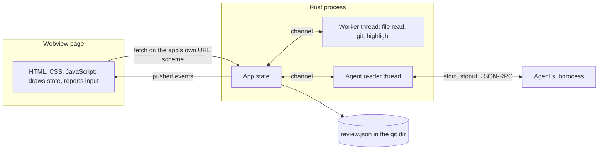

# Postil: design plan

Status: 2026-11-22. The UI layer is decided (a system webview through wry, core in Rust).
Milestones 0, 1, and 2 are built. Section "Decisions" lists what is settled and what is still
assumed.

Mockups: https://claude.ai/code/artifact/68e1a720-a3d5-4d71-92d4-9acd76ea9d5e (private to the
owner until shared).

## The problem in one sentence

An engineer opens a local repository, reads code, attaches notes to line ranges, sends the
collected notes to a coding agent over ACP, watches the agent work, and checks the resulting
changes: in one fast native window.

Everything below traces back to that sentence. The app is a reader with a notes tray and an agent
panel. It is not an editor, not a terminal, and not a PR tool.

## Not in scope

- Editing code by hand. The agent edits; the engineer reads and notes.
- A terminal, LSP, debugger, extensions, or plugin system.
- Pull requests, remote review, or any GitHub integration.
- Running several agents at once on one working tree. One run at a time per repository: two
  agents writing the same files conflict, and solving that means worktrees, which is a later
  step.
- Settings UI. Configuration is one JSON file.

## The loop

1. **Open.** `postil .` in a repository, or drop a folder on the window. The file list comes
   from `git ls-files` plus untracked files that are not ignored.
2. **Read.** A file tree on the left, a fuzzy finder on `Cmd-P`, one code pane with syntax colors.
3. **Note.** Select lines (drag in the gutter, or `v` then `j`/`k`), press `c`, type, `Cmd-Enter`.
   The note composer opens under the selected lines, inside the code, so the eyes do not move.
4. **Collect.** Notes list in the tray on the right, grouped by file. Clicking one jumps to its
   lines. Notes survive restarts.
5. **Send.** Pick an agent, press `Cmd-Shift-Enter`. The prompt preview shows the exact text the
   agent receives before it is sent.
6. **Watch.** The tray becomes the run panel: the agent's plan, its tool calls, its messages.
   Permission requests appear as a card with keys `a` (allow once), `Shift-a` (always), `r`
   (reject). `Esc` cancels the run.
7. **Verify.** The code pane switches to the changes the run made. Each note shows next to the
   lines that replaced it. Mark notes resolved, or write new notes on the changes and send them
   to the same session.

Step 7 closes the loop: the output of a run is reviewed with the same tool that produced the
notes.

## Look and feel

Inspiration: the Herdr desktop app. Read from its source (`herdrdev/herdr-app`, commit on
`master` as of 2026-11-22), its default look is: no title bar, inset window buttons, a 268 px
sidebar on a slightly lighter "chrome" color, panes as rounded cards (6 px radius, 6 px gaps,
1 px borders, an accent border on focus), Geist and Geist Mono fonts, and a low-contrast
`graphite` palette (`#17191d` background, `#d2d4d9` text, desaturated pastel syntax colors, a
steel accent `#a7b4c6`). We take the principles, not the pixels.

Rules for this app:

- **One accent, used rarely.** Steel blue for focus, selection, and the primary button. Amber is
  reserved for notes. Red appears only when the agent needs the engineer.
- **Cards on a canvas.** Three rounded panes with hairline borders and 8 px gaps. No toolbars, no
  icon rows, no status bar full of counters.
- **Code is the largest and brightest thing on screen.** Chrome text is dimmer than code text.
- **Two themes at launch:** Graphite (dark, default) and Paper (light). Each is a small palette
  of named colors, as in Herdr; a third theme is a new palette, not new code.
- **Focus mode.** `Cmd-\` hides both side panes. The code column centers at a readable width and
  a single pill in the corner carries the note count and the send action.
- **Fonts are bundled** (Geist, Geist Mono; SIL Open Font License). Bundling skips the system
  font scan at startup and makes the app look the same on every machine.

Motion: every animation is short and ends still.

| What | Duration | Curve |
|---|---|---|
| Hover and focus color | 80 ms | linear |
| Note composer opening under a line | 120 ms | ease-out |
| Side pane open and close | 160 ms | ease-out |
| Keyboard scroll (`j`, `k`, page keys, jump to note) | 120 ms | critically damped spring |
| Trackpad scroll | none added: follow the OS deltas exactly | |

The window draws only when something changed. An idle window draws zero frames.

## Architecture

A Rust core that owns all state, and a page in the system webview (WKWebView on macOS, through
wry) that draws it. Plain threads and channels for everything slow. No async runtime.



The boundary is narrow on purpose. The page asks for data with `fetch` on a custom URL scheme
(`postil://`), which the Rust process answers; no network socket is opened. Rust pushes
streaming events (agent updates) into the page. The page holds no state that matters: reloading
it loses nothing.

The frontend has no npm packages, no framework, and no build step: hand-written HTML, CSS, and
JavaScript modules compiled into the binary with `include_str!`. The fonts are compiled in too.

Why threads and not async: the app has three slow things (disk, `git`, one agent pipe). Each maps
to one thread with one channel. An executor would be one more moving part whose only job is to
schedule three tasks.

### Modules

| File | Holds |
|---|---|
| `src/main.rs` | Argument parsing; calls the library. |
| `src/shell.rs` | The window, the webview, the URL scheme handler, the event loop. |
| `src/app.rs` | `App` state and `App::update(Event)`. No drawing, no I/O: testable headless. |
| `src/repo.rs` | File listing, snapshots, and diffs by running the `git` binary. |
| `src/notes.rs` | `Note`, anchoring, and reading and writing `review.json`. |
| `src/acp/wire.rs` | Serde types for the ACP messages the app sends and receives. |
| `src/acp/connection.rs` | Spawning an agent, the reader thread, requests, notifications. |
| `src/highlight.rs` | tree-sitter highlighting: a file becomes lines of styled tokens. |
| `ui/index.html`, `ui/app.css`, `ui/app.js` | The page. `app.css` holds the two palettes as CSS variables. |

### Data structures

Chosen from what is looked up, iterated, and changed, and how often.

```rust
/// A note the engineer wrote on a line range.
struct Note {
    id: NoteId,                    // "N1", "N2": stable, shown in the UI and sent to the agent.
    path: RepoPath,                // Relative to the repository root.
    lines: LineRange,              // 1-based, inclusive.
    snippet: String,               // The selected text at the time of writing: the real anchor.
    body: String,
    state: NoteState,
}

enum NoteState {
    Open,
    Sent { run: RunId },
    Resolved,
    Outdated,                      // The snippet no longer exists in the file.
}
```

- **Notes** live in a `Vec<Note>`. A review holds tens of notes, so every operation is a scan.
  The line numbers are a cache: after a file changes, `relocate` finds the snippet nearest the
  old line and updates `lines`, or marks the note `Outdated`.
- **An open file** is one `String`, a `Vec<u32>` of line start offsets, and a sorted
  `Vec<(Range<u32>, Style)>` of highlight spans. Read-only text needs no rope. Drawing lines
  `a..b` is two slices and a binary search.
- **Shaped lines** are cached per visible line and dropped when the file or the width changes.
  Only visible lines are ever shaped, so a 50,000-line file costs the same per frame as a
  50-line one.
- **A run** is an append-only `Vec<RunItem>` (message, thought, plan, tool call, permission
  request) plus a `HashMap<ToolCallId, usize>` so a `tool_call_update` finds its row in O(1).
- **State on disk** is one file, `<git dir>/postil/review.json`, written atomically on every
  change. It sits inside the git directory, so it is never committed and needs no `.gitignore`
  entry. An agent or script can read and write notes by editing this file; the app reloads it on
  focus.

As built in milestone 2 (`src/notes.rs`):

- The file holds `{"version": 1, "notes": [...]}`; a note is `id` (`"N1"`), `path`, `lines`
  (`{start, end}`, 1-based, inclusive), `snippet`, `body`, and `state`. Unknown fields are
  refused, so a typo in a hand edit fails loudly instead of being dropped on the next write.
- `state` has only `open` and `outdated` so far: `Sent` and `Resolved` arrive with the
  milestones that set them. Open question for milestone 4: a sent note whose snippet the agent
  replaced is expected, not outdated, so anchoring may need to be a field of its own beside the
  lifecycle state rather than one more state.
- The Rust process keeps no copy. Every `api/notes` request reads the file and relocates every
  note. Only adding a note writes the file, with every note at its current place; reading never
  writes, so the refresh on focus cannot overwrite a hand edit. A file that does not parse, has
  another version, or repeats an id is reported with its path and never overwritten.
- Writers are not locked against each other; a change made by someone else between an add's
  read and its write (milliseconds) is lost. Acceptable while only the engineer adds notes.

### Working with the repository

The app runs the `git` binary. No libgit2, no gitoxide.

- File list: `git ls-files --cached --others --exclude-standard`.
- Snapshot before a run: `git add -A` and `git write-tree` against a temporary index file
  (`GIT_INDEX_FILE`). This captures the whole working tree, untracked files included, as one tree
  hash, and touches neither the real index nor the working tree.
- Changes after a run: the same snapshot again, then `git diff <before> <after>`.

No file watcher. The open file is re-read when a tool call that names it completes, when a run
ends, and when the window regains focus.

## ACP integration

ACP is JSON-RPC 2.0, one JSON object per line, over the agent subprocess's stdin and stdout. The
app is the client. Target: protocol version 1, the stable version. Version 2 has been a draft
since 2026-07-20 and changes how a turn ends; the app does not negotiate it.

### The messages the app uses

| Direction | Method | Used for |
|---|---|---|
| app to agent | `initialize` | Version and capabilities. The app advertises `fs` and `terminal` as false. |
| app to agent | `session/new` | `cwd` is the repository root, `mcpServers` is empty. |
| app to agent | `session/prompt` | The notes. The response's `stopReason` ends the turn. |
| app to agent | `session/cancel` | `Esc`. Every pending permission request is answered `cancelled`. |
| app to agent | `session/set_mode` | Only when the agent lists modes. |
| agent to app | `session/update` | `agent_message_chunk`, `agent_thought_chunk`, `tool_call`, `tool_call_update`, `plan`, `current_mode_update`. Unknown kinds are ignored. |
| agent to app | `session/request_permission` | The permission card. The reply names the chosen `optionId`. |

The app advertises no file or terminal capability on purpose. It has no unsaved buffers, so the
agent's own file tools see the same bytes the app does. That removes five client methods, and
version 2 removes them from the protocol anyway.

Permissions are never auto-approved from a tool call's `kind` or `title`: the agent writes those
labels. "Always" is offered only when the agent sends an `allow_always` option, and the choice is
the agent's to remember.

### The prompt

One text block, then one `resource_link` per file with notes. Every agent must accept both block
types, so no capability check is needed.

```text
These are review notes an engineer wrote while reading this repository.
Address every note. Change nothing the notes do not ask for.
When you finish, list each note id with one line on what you did.

[N1] src/acp/connection.rs:37
>     let reply = rx.recv().unwrap();
recv().unwrap() panics when the agent exits mid-request. Return
AcpError::AgentExited instead.
```

The quoted snippet travels with the note because line numbers go stale the moment the agent
edits the file.

### Agents

`~/.config/postil/agents.json` lists agents as a name and a command. Shipped defaults, to be
confirmed against each tool when the ACP milestone starts:

| Name | Command | ACP support |
|---|---|---|
| Claude | `npx -y @agentclientprotocol/claude-agent-acp` | Adapter around Claude Code. |
| Grok | `grok agent stdio` | Native. |
| Codex | `npx -y @zed-industries/codex-acp` | Adapter. |
| Gemini | `npx -y @google/gemini-cli --acp` | Native. |

Any other ACP agent works by adding a line. Login is not handled in version 1 of the app: when an
agent reports that it needs authentication, the run panel says which command to run in a terminal.

## Dependencies

Measured on 2026-11-22 with `cargo tree --target aarch64-apple-darwin -e normal,build`, counting
unique crates. Versions are the current stable releases on crates.io that day.

### Window, drawing, text

| Stack | Crates | Notes |
|---|---|---|
| winit 0.30.13 + softbuffer + tiny-skia + cosmic-text (CPU) | 84 | Fewest crates. Repaints a Retina window on one core: smooth scrolling is unproven. |
| eframe/egui 0.37.0, default features off, `glow` | 108 | OpenGL, which macOS deprecated. Not chosen. |
| winit 0.30.13 + wgpu 30.0.2 + glyphon 0.12.0 (own thin layer) | 112 | 114 with a clipboard crate. We write and maintain every widget. |
| eframe/egui 0.37.0, default features off, `wgpu` | 129 | The all-Rust fallback. Text field, IME, layout, and scrolling are upstream's to maintain. |
| **wry 0.57.3 + tao 0.37.3 (system webview, no Tauri)** | **77** | **Chosen.** UI in HTML, CSS, and JavaScript, so not all Rust. Looks and text input come from the webview. |
| iced 0.14.0 | 151 | Last release 2025-12-07. |
| Tauri 2.12.7 | 207 to 211 | The same webview plus bundling, plugins, and a permission system. |
| eframe/egui 0.37.0, default features | 177 | The defaults add accessibility, clipboard, system fonts, X11, and Wayland. |
| gpui-ce 0.3.0 (community fork) | 294 | What Herdr's look is built on, in fork form. |
| gpui 0.2.2 (official crate) | 449 | Stale on crates.io since 2025-10; Herdr vendors and patches seven copies of its fork. |

The choice is wry, decided 2026-11-22. It is the smallest tree measured, and it removes the two
largest risks of the native options: the look (the mockups are already HTML and CSS) and the
text field (cursor, selection, IME, and accessibility come from WebKit). Tauri was rejected
because it adds about 130 crates for bundling, plugins, an updater, and a permission system this
app does not use.

The downside accepted: the UI layer is JavaScript, and a webview uses more memory and starts
slower than a native window. Milestone 0 measures both. If they fail the targets, the fallback
is trimmed egui; restyled egui apps such as `maziluiosif/oxi` and the Rerun Viewer show it can
reach a comparable look, with motion unverified.

### ACP

| Approach | Crates | Notes |
|---|---|---|
| **serde + serde_json, hand-written types** | **11** | **Recommended.** About twelve message types; unknown fields ignored. |
| agent-client-protocol-schema 1.21.2 | 41 | Upstream wire types. Twenty-one minor releases so far: frequent churn. |
| agent-client-protocol 5.5.1 (SDK) | 79 | Full client and agent SDK, futures-based. |

The app uses a small, stable part of version 1. Hand-written types cost roughly 250 lines and
keep the reader thread synchronous. The upstream schema is the reference, and the end-to-end
tests run against real agents' message shapes through a fake agent.

### Syntax colors

| Approach | Crates | Notes |
|---|---|---|
| **tree-sitter 0.27.2 + tree-sitter-highlight** | **26** | **Recommended.** Plus one grammar crate per language (C code, built with `cc`). |
| syntect 5.3.0 | 45 | Regex grammars; slower to load. |

Languages built in: Rust, JavaScript, TypeScript and TSX, Python, Go, JSON, TOML, Bash. Other
files show as plain text. Markdown is not included yet: its grammar is two grammars joined by
injections, which the highlighter does not run. Each grammar is compiled on first use, so launch
pays for none of them. The eight grammars took the release binary from 3.6 MB to 9.1 MB.

### Expected total

An estimate, not a measurement: about 150 crates for the whole app (the three recommended rows
share some crates, and eight grammar crates are added). A GPUI app starts at 294 to 449 before
any application code.

## Performance targets

These are targets, not measurements. The spike measures them on the development machine; a target
that fails changes the plan, not the number.

| Measure | Target |
|---|---|
| Launch to first painted frame | under 100 ms |
| Open a 10,000-line file to first paint (colors may arrive later) | under 16 ms |
| CPU time per frame while scrolling | under 4 ms |
| CPU when idle | 0%: no frames drawn |
| Memory with one repository open | under 80 MB |
| Stripped release binary | under 10 MB |

### Milestone 0 measurements

Measured 2026-11-22 on the development Mac with `postil <repo> --bench src/big.rs`, a release
build, warm runs (the first run after a build is slower). The file is 10,007 lines of Rust. The
egui column is a probe, not the app: an empty trimmed-egui window (eframe 0.37.0, `wgpu`) that
draws 60 lines of text, with no repository, no highlighting, and no file. It is a floor for egui.

| Measure | wry app | egui probe | Target |
|---|---|---|---|
| Launch to painted file, warm | about 500 ms (445 ms with a one-line file) | about 200 ms | missed by both |
| Launch, first run after a build | 710 ms | 543 ms | |
| Scroll, 300 frames of 120 px | 17 ms median, 21 ms worst, 0 slow frames (60 fps) | not measured | |
| Open the 10,007-line file | about 120 ms, two frames of waiting included | not measured | missed |
| Memory, 10,007-line file open | about 255 MB: 115 MB app, 140 MB WebKit helpers | not measured | missed |
| Memory, one-line file open | about 173 MB: 97 MB app, 76 MB WebKit helpers | 108 MB | missed by both |
| Stripped release binary | 3.6 MB with one grammar, 9.1 MB with eight | 7.5 MB | met |

Where the 500 ms goes: 35 ms opening the repository and compiling the highlight queries, 95 ms
creating the application and window, 90 ms creating the webview, 85 ms for WebKit to start its
page process, 85 ms from the page arriving to its script running, and the rest listing files,
highlighting, and drawing. About 270 ms is the webview's own start, outside our code. Serving
the page as one response with its data embedded was tried and changed nothing.

The 100 ms launch and 80 MB memory targets were set before any measurement and neither stack
meets them. Milestone 0's gate (launch over about 300 ms) is failed by wry on the numbers: it
costs about 300 ms of launch and 65 MB or more of memory over the egui floor, and buys the look,
the text field, and the smaller dependency tree. The owner ran the app on 2026-11-22 with these
numbers in hand and chose to continue on wry ("looks good for starters"). The 300 ms gate is
retired; the measured numbers above are the baseline to not regress.

## Milestones

0. **Spike (the gate).** Mockup 1 as a real window on wry: the file list, a 10,000-line file with
   colors in a virtual list, and the note composer. A bench mode measures launch time, memory,
   and scroll frame time. If launch is over about 300 ms or scrolling drops frames, switch the UI
   to trimmed egui and keep everything below unchanged: `app.rs`, `notes.rs`, `repo.rs`, and
   `acp/` do not depend on the UI layer.
1. **Read.** Open a repository, file tree, fuzzy finder, highlighting, both themes. Built: the
   finder is the sidebar's filter box (`Cmd-P` focuses it, arrows move, Enter opens).
2. **Note.** Line selection, the composer, the tray, `review.json`, anchoring across file changes.
   Built: the page saves through `POST api/notes` and reads the file and the notes again when
   the window regains focus; outdated notes stay in the tray, dashed, and are not drawn on code.
   Not built: editing or deleting a note in the app (edit `review.json` by hand for now).
3. **Send.** The ACP connection, the prompt preview, the run panel, permissions, cancel.
4. **Verify.** Snapshots, the changes view, resolving notes, follow-up prompts in the same session.
5. **Polish.** Motion, focus mode, `agents.json`, an app bundle for macOS.

## Testing

- **End to end first.** A fake ACP agent (a small binary in `tests/`) speaks real JSON-RPC over
  real pipes. Tests drive `acp::Connection` against it: a full turn, a permission round trip,
  cancel, a malformed line, the agent exiting mid-request.
- **Repository code** runs against real `git` in a temporary directory: snapshot, edit, diff.
- **App logic** is tested through `App::update` with no window: select lines, write a note, send,
  receive updates, resolve.
- **Note anchoring** gets property tests: insert or delete lines above, inside, and below a note.
- **The page's logic** that does not touch the document (fuzzy ranking) lives in its own module
  with tests beside it, run by Node's built-in runner: `node --test ui/`. `cargo test` runs them
  too, through `tests/page_logic.rs`, so Node must be installed to run the suite.
- **The page's look and input handling** are checked by eye. Pixel tests are not planned for
  version 1.

## Decisions

Decided:

1. **UI layer.** A system webview through wry, with a hand-written frontend and the core in
   Rust. Decided 2026-11-22 and kept after the milestone 0 measurements. Rejected: Tauri (crate
   count), GPUI (crate count, no maintained release), our own drawing layer (we would maintain
   the text field).

Assumed until someone objects:

2. **ACP client.** Hand-written on serde_json, not the upstream schema crate or the full SDK.
3. **Platforms.** macOS only at first, with Linux later. On Linux wry uses WebKitGTK, a different
   engine build, so the look needs its own check there.
4. **The look.** Graphite as default with Paper as the light theme, three panes with focus mode,
   as in the mockups, or changes to them.
5. **Where notes live.** Inside the git directory, private to the clone (recommended), or a
   tracked file in the repository that teammates can see.
6. **Name.** Postil, chosen 2026-11-22: a postil is a note written in the margin of a text. The
   name was free on crates.io and Homebrew that day; trademarks and domains were not checked.

## Sources

- ACP schema, version 1: https://agentclientprotocol.com/protocol/v1/schema
- ACP Rust SDK: https://github.com/agentclientprotocol/rust-sdk and
  https://docs.rs/agent-client-protocol/5.5.1/agent_client_protocol/
- ACP agent registry: https://github.com/agentclientprotocol/registry
- ACP version 1 against the version 2 draft:
  https://safeguard.sh/resources/blog/agent-client-protocol-explained-how-editors-talk-to-coding-agents-and-how-to-secure-it
- Herdr app source (stack, layouts, palettes): https://github.com/herdrdev/herdr-app
- Herdr site: https://herdr.dev/
