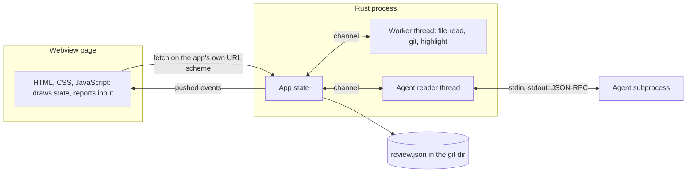

# Postil: design plan

Status: 2026-11-23. The UI layer is decided (a system webview through wry, core in Rust).
Milestones 0 to 4 are built, and milestone 5 is under way. Section "Decisions" lists what is
settled and what is still assumed.

Mockups: https://claude.ai/code/artifact/68e1a720-a3d5-4d71-92d4-9acd76ea9d5e (private to the
owner until shared).

## The problem in one sentence

An engineer opens a local repository, reads code, attaches notes to line ranges, sends the
collected notes to a coding agent over ACP, watches the agent work, and checks the resulting
changes: in one fast native window.

Everything below traces back to that sentence. The app is a reader with a notes tray and an agent
panel. It is not an editor, not a terminal, and not a PR tool.

## Not in scope

- Editing code by hand. The agent edits; the engineer reads and notes.
- A terminal, LSP, debugger, extensions, or plugin system.
- Pull requests, remote review, or any GitHub integration.
- Running several agents at once on one working tree. One run at a time per repository: two
  agents writing the same files conflict, and solving that means worktrees, which is a later
  step.

## The loop

1. **Open.** `postil .` in a repository; or `postil` alone, which shows the welcome screen:
   Open Folder (`Cmd-O`, the native dialog), the recent projects, or a folder dropped on the
   window. A folder outside any repository gets an offer to make it one (`git init`). One
   window shows one project; opening another replaces it, and the project name in the sidebar
   leads back to the welcome screen. The file list comes from `git ls-files` plus untracked
   files that are not ignored.
2. **Read.** A file tree on the left, a fuzzy finder on `Cmd-P`, one code pane with syntax colors.
3. **Note.** Select lines (drag in the gutter, drag across the code text, or `v` then `j`/`k`),
   press `c` or right-click and choose Add note, type, `Cmd-Enter`. The note composer opens
   under the selected lines, inside the code, so the eyes do not move. The right-click menu
   also copies the selection (code only, never the line numbers) and its `path:lines`
   reference. `v`/`j`/`k` is not built yet.
   A note can also be on a whole file or folder: right-click its row in the file list and
   choose Add Note (or press `c` on a focused row). A dialog takes the text and offers Save,
   which keeps the note in the tray, and Send to the default agent, which keeps it and sends it
   alone at once. Both store the note first, so a send that fails leaves it to send again.
   Asked for by the owner on 2026-11-24, as a modal over the window rather than the inline
   composer, which belongs to lines of code.
4. **Collect.** Notes list in the tray on the right, grouped by file. Clicking one jumps to its
   lines. Notes survive restarts.
5. **Send.** Pick an agent, press `Cmd-Shift-Enter`. The prompt preview shows the exact text the
   agent receives before it is sent.
6. **Watch.** The tray becomes the run panel: the agent's plan, its tool calls, its messages.
   Postil allows the agent's tool calls itself; only a question the agent asks stops for the
   engineer, answered in the note's or the run's dialog. `Esc` cancels the run.
7. **Verify.** The code pane switches to the changes the run made. Each note shows next to the
   lines that replaced it. Mark notes resolved, or write new notes on the changes and send them
   to the same session.

Step 7 closes the loop: the output of a run is reviewed with the same tool that produced the
notes.

## Look and feel

Inspiration: the Herdr desktop app. Read from its source (`herdrdev/herdr-app`, commit on
`master` as of 2026-11-22), its default look is: no title bar, inset window buttons, a 268 px
sidebar on a slightly lighter "chrome" color, panes as rounded cards (6 px radius, 6 px gaps,
1 px borders, an accent border on focus), Geist and Geist Mono fonts, and a low-contrast
`graphite` palette (`#17191d` background, `#d2d4d9` text, desaturated pastel syntax colors, a
steel accent `#a7b4c6`). We take the principles, not the pixels.

Rules for this app:

- **One accent, used rarely.** Steel blue for focus, selection, and the primary button. Amber is
  reserved for notes. Red appears only when the agent needs the engineer.
- **Cards on a canvas.** Three rounded panes with hairline borders and 8 px gaps. No toolbars, no
  icon rows, no status bar full of counters.
- **Resizable panes.** The file list (200 to 480 px) and the tray (280 to 720 px) are sized by
  dragging the divider in the gap beside them, or with the arrow keys on a focused divider;
  a double-click resets one. The file list does not fold: at 200 px its foot still shows the
  Settings button whole, and the owner asked on 2026-11-23 for no narrower list. The code pane
  keeps at least 420 px: in a narrow window the tray gives way first, then the file list. The
  widths are kept per Mac in `~/.config/postil/layout.json`, chosen by the owner on 2026-11-23
  over per project; like `recent.json` it is a convenience, so a file that cannot be used
  counts as the defaults.
- **Code is the largest and brightest thing on screen.** Chrome text is dimmer than code text.
- **Two themes at launch:** Graphite (dark, default) and Paper (light). Each is a small palette
  of named colors, as in Herdr; a third theme is a new palette, not new code.
- **Focus mode.** `Cmd-\` (View > Focus Mode) hides both side panes. The code column centers at a
  readable width (at most 1100 px) and a single pill in the corner carries the open notes'
  count and Send, which leaves focus mode for the send step. Built in milestone 5.
- **Fonts are bundled** (Geist, Geist Mono; SIL Open Font License). Bundling skips the system
  font scan at startup and makes the app look the same on every machine.

Motion: every animation is short and ends still.

| What | Duration | Curve |
|---|---|---|
| Hover and focus color | 80 ms | linear |
| Note composer opening under a line | 120 ms | ease-out |
| Side pane open and close (focus mode) | 160 ms | ease-out |
| Dialog, toast, the changes view and the prompt preview coming in | 120 ms | ease-out |
| Keyboard scroll (`j`, `k`, page keys, jump to note) | 120 ms | critically damped spring |
| Trackpad scroll | none added: follow the OS deltas exactly | |

The window draws only when something changed. An idle window draws zero frames. Every animation
is off when macOS's Reduce Motion is on (`prefers-reduced-motion`). The side panes ease only
while focus mode changes, never while a divider is dragged, which follows the pointer at once.
Keyboard scroll waits for `j` and `k`, which are not built.

## Architecture

A Rust core that owns all state, and a page in the system webview (WKWebView on macOS, through
wry) that draws it. Plain threads and channels for everything slow. No async runtime.



The boundary is narrow on purpose. The page asks for data with `fetch` on a custom URL scheme
(`postil://`), which the Rust process answers; no network socket is opened. Rust pushes
streaming events (agent updates) into the page. The page holds no state that matters: reloading
it loses nothing.

The frontend has no npm packages, no framework, and no build step: hand-written HTML, CSS, and
JavaScript modules compiled into the binary with `include_str!`. The fonts are compiled in too.

Why threads and not async: the app has three slow things (disk, `git`, one agent pipe). Each maps
to one thread with one channel. An executor would be one more moving part whose only job is to
schedule three tasks.

### Modules

| File | Holds |
|---|---|
| `src/main.rs` | Argument parsing; calls the library. |
| `src/shell.rs` | The window, the webview, the event loop, and the request thread that answers the page. |
| `src/site.rs` | The API the page calls over the URL scheme (`Site`), and the page's own files. |
| `src/app.rs` | `App` state and `App::update(Event)`. No drawing, no I/O: testable headless. |
| `src/repo.rs` | File listing, snapshots, and diffs by running the `git` binary. |
| `src/notes.rs` | `Note`, anchoring, and reading and writing `review.json`. |
| `src/recent.rs` | The recent projects, `~/.config/postil/recent.json`, for the welcome screen. |
| `src/layout.rs`, `ui/panes.js` | The pane widths, `~/.config/postil/layout.json`, and the rules for dragging and fitting them. |
| `src/settings.rs` | The settings, `~/.config/postil/settings.json`, and their rules. |
| `src/agents.rs` | The agent catalog, the login shell's `PATH`, and finding installed agents. |
| `src/files.rs` | Atomic file writes and the configuration directory. |
| `src/dialog.rs` | The native Open Folder dialog (`NSOpenPanel` through objc2, no new crates). |
| `src/menu.rs` | The macOS menu bar through `muda`; its commands run in the page. |
| `scripts/bundle.sh` | Builds `target/release/Postil.app` with the icon from `assets/`. |
| `src/acp/wire.rs` | Serde types for the ACP messages the app sends and receives. |
| `src/acp/connection.rs` | Spawning an agent, the reader thread, requests, notifications. |
| `src/run.rs` | Runs: the prompt, the agent kept between runs. |
| `src/run/log.rs` | The run log: a run in memory and its file on disk. |
| `src/highlight.rs` | tree-sitter highlighting: a file becomes lines of styled tokens. |
| `ui/index.html`, `ui/app.css`, `ui/app.js` | The page. `app.css` holds the two palettes as CSS variables; `app.js` holds the page's state and wires the views. |
| `ui/code-view.js`, `ui/file-list.js`, `ui/notes-tray.js`, `ui/context-menu.js`, `ui/welcome.js`, `ui/dividers.js` | One view each: the code pane with its selection and composer, the file tree, the tray's notes and the send step, the right-click menu, the welcome screen, the pane dividers. |
| `ui/dom.js`, `ui/dialog-parts.js`, `ui/question-form.js` | Helpers the views share: `el()`, icons, the toast and two-click delete; the parts both dialogs draw; the question form. |
| `ui/settings.js`, `ui/settings-dialog.js` | The settings dialog: its rules (tested with `node --test`) and its drawing. |
| `ui/run.js`, `ui/run-panel.js` | The send step's and the run panel's rules (tested with `node --test`), and the run panel: `run-store.js` reads the runs, `run-tab.js` and `run-dialog.js` draw them. |
| `ui/status.js`, `ui/note-dialog.js` | Each note's status from its run (tested with `node --test`), and the note detail dialog. |

### Data structures

Chosen from what is looked up, iterated, and changed, and how often.

```rust
/// A note the engineer wrote on lines, a whole file, or a whole folder.
struct Note {
    id: NoteId,                    // "N1", "N2": stable, shown in the UI and sent to the agent.
    path: RepoPath,                // Relative to the repository root.
    target: Target,                // What the note is on. Version 4 on.
    body: String,
    anchor: Anchor,                // Whether the target is still there.
    state: NoteState,              // Where the note is in the loop. From milestone 3 on.
}

enum Target {
    Lines {
        lines: LineRange,          // 1-based, inclusive.
        snippet: String,           // The selected text at the time of writing: the real anchor.
    },
    Path(PathKind),                // The whole file or folder at `path`.
}

enum Anchor {
    Found,
    Lost,                          // The snippet, or the file or folder, no longer exists.
}

enum NoteState {
    Open,
    Sent { run: RunId },
    Resolved { run: Option<RunId> }, // The run it was sent in last, so its dialog keeps it.
}
```

- **Notes** live in a `Vec<Note>`. A review holds tens of notes, so every operation is a scan.
  The line numbers are a cache: whenever the notes are read, `locate` keeps a note where its
  snippet still is, moves it to the only other copy, or marks its anchor `Lost`. It never picks
  the nearest of several copies (see "Notes and their status"). A file or folder note is found
  while its path is still a file or folder of that kind; a rename is not followed.
- **The target is an enum** because a file or folder note has no lines and no snippet, and
  optional fields would let a note have one without the other. Decided 2026-11-24 with the
  owner, over a separate kind of run that sends a path with no note: a note keeps every view
  (status, dialogs, reviews, follow-ups) working on it unchanged.
- **Anchor and state are two fields** because they answer two questions, decided 2026-11-22.
  A sent note whose text the agent replaced is the expected result of a run; an open note whose
  text vanished means the code drifted under it. The verify view shows these differently, and
  one enum would need a variant for every combination.
- **An open file** reaches the page as lines of tokens, each a style class and a slice of the
  text (`highlight.rs`). Read-only text needs no rope.
- **Visible lines only**: the code pane is a virtual list (`ui/code-view.js`) that builds rows
  only for the lines near the viewport, so a 50,000-line file adds no rows beyond those of a
  50-line one.
- **A run** is an append-only `Vec<Entry>` (message part, thought, tool call, tool call
  change, plan, permission request and answer, end), the same lines as its log on disk. A
  tool call's later changes are entries of their own, and the page folds them into the call:
  the log stays append-only, and the page fetches only the entries it has not seen. Section
  "Runs" has the rest.
- **State on disk** is one file, `<git dir>/postil/review.json`, written atomically on every
  change. It sits inside the git directory, so it is never committed and needs no `.gitignore`
  entry. An agent or script can read and write notes by editing this file; the app reloads it on
  focus.

As built in milestone 2 (`src/notes.rs`):

- The file holds `{"version": 1, "notes": [...]}`; a note is `id` (`"N1"`), `path`, `lines`
  (`{start, end}`, 1-based, inclusive), `snippet`, `body`, and `anchor` (`found` or `lost`,
  optional on read because every read recomputes it). Unknown fields are refused, so a typo in
  a hand edit fails loudly instead of being dropped on the next write.
- **Every new field is a new format version.** A build refuses fields it does not know, so a
  milestone 2 build reading a file with milestone 3's `state` must fail on "version 2", not on
  "unknown field". Milestone 3 therefore writes version 2 and still reads version 1, with
  `state` defaulting to `open`. Milestone 4's resolved state is version 3.
- **Version 4** adds `target`: `"lines"`, `"file"` or `"folder"`, written for every note. A
  line note keeps `lines` and `snippet`; a file or folder note has neither, and a note whose
  fields do not fit its target is refused. An older file reads with every note on lines. The
  page adds one with `POST /api/notes {path, target, body}`; the path must be written as git
  writes it (no `.`, `..`, empty names or trailing `/`) and be a file or folder as `target`
  says now, or the request fails with 400. A symlink is a file wherever it points, as git
  tracks it and the file list shows it. A folder note's dialog lists the files the run changed
  below the folder, each with its counts, rather than their diffs, which the run's Changes
  view shows.
- **Resolving a note** (`POST /api/notes/resolve?id=N1`) keeps the run it was sent in, so its
  dialog still shows what that run did; `POST /api/notes/reopen?id=N1` puts it back to sent in
  that run, or open when it was never sent. Only Reopen takes a note out of Resolved: a send
  naming a resolved note is refused (400), and a run that takes its turn after the note was
  resolved leaves it resolved, with that run. The tray lists resolved notes last, and the page
  offers no send for them.
- **Placing a note:** it stays where its snippet still is, or moves to the only other copy of
  the snippet; with several copies and none at its last lines its anchor is lost. The nearest
  copy is not taken: short lines such as `}` repeat, and the nearest is often the wrong one.
  Storing a few lines of context around the snippet would place more of these notes; that is
  a new field, so a new version, left for when lost notes on repeated lines prove common.
- **Adding a note:** the page sends the text it showed with the line numbers. When the file
  changed meanwhile, the note goes where that text is now (same rule), or the request fails
  with 409 and the draft stays in the composer.
- The Rust process keeps no copy. Every `api/notes` request reads the file and places every
  note. Only a change (add, delete, resolve, reopen, marking sent) writes the file, with every
  note at its current place; reading never writes, so the refresh on focus cannot overwrite a
  hand edit. A file that does not parse, has another version, or repeats an id is reported
  with its path and never overwritten.
- An add holds an exclusive lock on `<git dir>/postil/review.lock` from its read to its rename,
  so two app windows on one working tree keep each other's notes. A script that edits
  `review.json` without that lock can lose an edit made during an add.

### Working with the repository

The app runs the `git` binary. No libgit2, no gitoxide.

- File list: `git ls-files --cached --others --exclude-standard`.
- Snapshot before a run: `git add -A` and `git write-tree` against a temporary index file
  (`GIT_INDEX_FILE`). This captures the whole working tree, untracked files included, as one tree
  hash, and touches neither the real index nor the working tree.
- Changes after a run: the same snapshot again, then `git diff <before> <after>`.

No file watcher. The open file is re-read when a tool call that names it completes, when a run
ends, and when the window regains focus.

## ACP integration

ACP is JSON-RPC 2.0, one JSON object per line, over the agent subprocess's stdin and stdout. The
app is the client. Target: protocol version 1, the stable version. Version 2 has been a draft
since 2026-07-20 and changes how a turn ends; the app does not negotiate it.

### The messages the app uses

| Direction | Method | Used for |
|---|---|---|
| app to agent | `initialize` | Version and capabilities. The app advertises `fs` and `terminal` as false, and form questions (`elicitation.form`). |
| app to agent | `session/new` | `cwd` is the repository root, `mcpServers` is empty. |
| app to agent | `session/prompt` | The notes. The response's `stopReason` ends the turn. |
| app to agent | `session/cancel` | `Esc`. Every pending permission request is answered `cancelled`, every open question `cancel`. |
| agent to app | `session/update` | `agent_message_chunk`, `agent_thought_chunk`, `tool_call`, `tool_call_update`, `plan`. Other kinds, and kinds or enum values newer than the pinned schema, are ignored or read as "other". |
| agent to app | `session/request_permission` | Answered at once with the allow option (once, else always). With none, it waits for the engineer. |
| agent to app | `elicitation/create`, `session/create_elicitation` | A question as a form; the reply is `accept` with the form's values, `decline` (skipped), or `cancel`. Unstable in ACP; the first name is the schema's at the pinned commit, the second Claude's adapter's. A URL question is refused. |
| agent to app | `$/cancel_request` | The agent withdraws a request; an open question closes unanswered. |

The app advertises no file or terminal capability on purpose. It has no unsaved buffers, so the
agent's own file tools see the same bytes the app does. That removes five client methods, and
version 2 removes them from the protocol anyway.

The app does not set a mode (`session/set_mode`): the agent's default applies. Requests the
app does not serve (`fs/*`, `terminal/*`, anything newer) are answered "method not found",
and notifications it does not know (Grok's `_x.ai/...`, Claude's `_auth/...`) are ignored.
`src/acp/wire.rs` names the schema commit the types were written from.

Every permission request is allowed, whatever the tool call: the owner decided on 2026-11-23
that runs go without permission prompts, and that only the agent's questions stop for the
engineer. A request is allowed once when the agent offers that, else always; one with no
allow option waits, as before. Postil advertises form questions because Claude's adapter
otherwise sends its questions (`AskUserQuestion`) as permission requests, which auto-allow
would wave through unanswered (checked in claude-agent-acp at 130fbbc, `src/v1/acp-agent.ts`).
How Grok asks a question is not checked yet.

### The prompt

One text block, then one `resource_link` per file with line or file notes. Every agent must
accept both block types, so no capability check is needed.

```text
These are review notes an engineer wrote while reading this repository.
Address every note. Change nothing the notes do not ask for.
When you finish, list each note id with one line on what you did.

[N1] src/acp/connection.rs:37
>     let reply = rx.recv().unwrap();
recv().unwrap() panics when the agent exits mid-request. Return
AcpError::AgentExited instead.

[N2] src/acp/ (folder)
Split this module by message kind.

[N3] README.md (file)
Document the --bench flag.
```

The quoted snippet travels with the note because line numbers go stale the moment the agent
edits the file. A file or folder note quotes nothing: the agent reads the path itself. A folder
gets no `resource_link`, because agents read a link as a file; the path in the text names it.
A file or folder that is gone says so under its heading, as lost lines do. The send step lists
the linked files as `GET /api/run/preview` returns them (`files`).

### Runs

Built in `src/run.rs` and `src/run/log.rs`, with the API the page calls (`src/site.rs`):

| Route | Does |
|---|---|
| `GET /api/run/preview?notes=N1,N2` | The prompt's text, exactly as the agent receives it. |
| `POST /api/run` `{notes, agent?}` | Starts a run with the notes, in that order; the agent is the settings' one unless named. |
| `GET /api/run?after=N` | The latest run, with its entries from number `N` on, and its notes and prompt only when `N` is 0: they never change; `null` when there is none. |
| `GET /api/run?id=R2` | One run, whole: this window's when it is that one, else read from its log. |
| `GET /api/runs` | The ids of the runs on disk, newest first. |
| `POST /api/run/permission` `{request, option}` | Answers a permission request with an option the agent offered (one with no allow option, which Postil does not answer itself). |
| `POST /api/run/question` `{request, content}` | Answers a question with the form's values, or skips it (`content` `null`). |
| `POST /api/run/cancel` | Cancels the run; open permission requests are answered `cancelled`. |

- **The agent is kept between runs**, with its session, until a send names another agent or
  command, the project closes, the agent exits, or a turn fails (its session may be broken);
  the next send then starts it again. The
  owner chose this on 2026-11-23 over a fresh agent per send, so milestone 4's follow-up notes
  reach the same conversation.
- **One run at a time** per working tree: a send during a run is refused (409), and a live
  run holds an exclusive lock on `runs/active.lock`, so another window on the same working
  tree is refused too.
- **Stop** asks the agent to cancel (`session/cancel`), and answers its open permission
  requests `cancelled`, as well as any that arrive until the turn ends. An agent that is
  still starting is killed instead, and the run ends at once. A second Stop from 3 s after
  the first kills an agent that did not stop, so a hung agent never holds the working tree;
  sooner, it is the same request (a double click).
- **Permission requests and questions** are numbered together by `acp::Agent`, which keeps
  the only table of open ones; the log records each and its answer by that number. A
  permission request is answered as it is logged (auto-allow); a question waits for
  `POST /api/run/question` `{request, content}`, `content` the form's values or `null` to
  skip. Stop answers open questions `cancel`, and an agent's withdrawal closes one.
- **Starting** happens on a thread of its own, because it can take minutes. Each start-up
  step (`initialize`, `session/new`) may take 120 seconds, and Stop ends the wait. Gemini 0.40.1, not signed in,
  never answers `initialize` (it waits for a browser sign-in), checked 2026-11-23; the run
  then fails with the hint to run the agent in a terminal.
- **The log** is `<git dir>/postil/runs/R<n>.jsonl`: a header line (agent, notes, prompt,
  start time), then one line per entry, appended as it happens. The owner chose on 2026-11-23
  to keep runs on disk. Creating the file claims the id, so two windows never share one. After
  a restart the newest readable log is shown; one without an end reads as unfinished (the
  app quit during it, or another window runs it). Lines are decoded one by one, so a torn
  write spoils only its line, which is reported; an unreadable newer log is skipped and
  named. Nothing is synced: a crash costs at most the last lines.
- **Notes** are marked sent, with the run's id, once the agent shows it took the turn: its
  first update, a permission request, or a stop. A run that fails to start, or whose prompt
  the agent refuses, leaves them open. `review.json` is version 2 for this field, `state`,
  always an object: `{"kind": "open"}` or `{"kind": "sent", "run": "R3"}`. Version 1 files
  read with every note open.
- **A run goes with its last note.** Deleting a note deletes the log of every run none of
  whose notes is left (asked by the owner on 2026-11-23). A run with other notes keeps its log;
  this window's live run keeps it until a delete after it ends. Run numbers are never given
  again: the highest one used is kept in `runs/active.lock`, so a page that read R5 never
  takes a new run for it. Note ids still can be (a deleted highest note's number is given
  again): a run that keeps other notes lists the new note under the old id, and shows the
  old reply's line for it. Never reusing note ids needs the next id in `review.json`, a new
  format version; not done yet.
- **The page** is told about changes by a script call (`window.postil.runChanged()`) and
  fetches the entries it has not seen. Calls are coalesced: none is queued while one is
  pending, since an agent streams its reply in many small parts.
- Closing the project or quitting kills the agent's process group (`npx` leaves `node`
  running), a starting agent's too. A run cut short this way reads as unfinished.

### Notes and their status

The tray shows each note with where it is in the loop, worked out in the page
(`ui/status.js`) from the note's sent mark and its run: the live run from the run panel, any
other read once by id (`GET /api/run?id=R2`) and kept, since a finished run does not change.
One source of run state, the log, so the Rust process has no second summary to keep in step.

- **Statuses:** Open; Starting, Working (or Stopping) and Needs you while its run is live;
  then Addressed when the agent's reply has a line for the note (`N3: ...`, which the prompt
  asks for), No word when it has none, Stopped, Failed, or Unfinished. A note whose turn the
  agent refused is open again. The tray groups them: in the live run, open, and done, newest
  run first.
- **The note detail** (`ui/note-dialog.js`) opens from a card: the note, its lines, what the
  agent said about it, and the run's history for it (tool calls on its file, plan steps that
  name it). Show in code closes it and scrolls to the note. For a folder note the history and
  the diffs are those of every file below the folder, and Show in files opens the folder in the
  file list (`ui/note-place.js`, `covers`).
- **Sending one note:** the arrow on a card, or Send in the detail, sends that note alone to
  the default agent at once and stays on the notes; Shift-click opens the send step with only
  it ticked. Decided with the owner on 2026-11-23. A run that starts no longer takes the tray
  to the Run tab unless it came from the send step; one that needs the engineer still does.

### Reviews

A Review button in a run's dialog, and in the dialog of each of its notes, sends the run's
work to the settings' reviewers in order (`src/review.rs`, `POST /api/run/review {of}`). The
work is the run's prompt, its reply, and the diffs its finished edits made. Decided with the
owner on 2026-11-23:

- **Every reviewer but the last proposes, read-only.** Postil rejects its tool calls but reads,
  searches, fetches and thinking, and its prompt says not to change files. That stops only
  the calls an agent asks permission for; an agent set to edit without asking is caught when
  its turn ends, by the edits its run reports, and the review stops there. An edit made
  through a command reports none. The reviewer ends its reply with its findings as a JSON
  array fenced as json, which Postil reads and logs as the run ends; the findings are
  numbered `F1`, `F2`, ... across the chain. The prompt gives the format in words, not as an
  example block, which an agent quoting it would make read as findings.
- **The last of two or more judges.** It gets every finding, accepts or rejects each, makes the
  accepted changes, and ends with one line per finding (`F1: accepted - ...`). A single
  reviewer only proposes.
- **Each stage is a run,** marked in its header with the run it reviews and its place in the
  chain, started with a fresh agent when the one before ends well: a reviewer never inherits
  the reviewed agent's conversation. That replaces the agent kept for follow-ups, and a send
  after a review starts a fresh agent too, never a reviewer's. A stage that fails or is
  stopped ends the review, and a send ends one between stages. A review marks no note sent.
  The run log is version 2 for the review header field and the `findings` entry; version 1
  logs read as runs of notes.
- **Findings live in the work, not as notes or runs of their own.** The Run tab lists only runs
  of notes; a run's dialog has a Review section with a card per reviewer (it opens that
  reviewer's run) and a card per finding with its verdict (it opens the finding whole), and a
  note's dialog shows the findings about that note, in full.

### Follow-ups

A run's dialog ends with a box for a follow-up: what the engineer asks next about the run's
work (`POST /api/run/follow {of, text}`, `Runner::follow_up`). Decided with the owner on
2026-11-23: a follow-up is a new run, threaded under the run it follows.

- **The same conversation when it still exists.** The follow-up goes to the agent that ran the
  thread's latest run. When the kept agent is that agent and ran that run, it gets the
  engineer's words alone, as the next prompt of its session. Otherwise (the agent exited, a
  review or another send replaced it, or Postil restarted) a fresh agent gets the thread's
  earlier prompts and replies first, then the words, with the edited files linked; the
  follow-up's dialog says so.
- **A thread does not fork.** A follow-up of a run another run already follows is refused
  (400, naming the run to follow up instead): two windows, or a stale page, would otherwise
  make two threads that each leave the other's work out of a fresh agent's prompt.
- **A follow-up carries its thread's notes** and marks none sent: it goes with them when the
  last is deleted, and a note's status shows the follow-up only while it runs.
- **The header** holds `followUp: {of, text}`, the run it follows and the engineer's words, so
  the dialog shows the words and not the longer prompt a fresh agent got. The run log is
  version 3 for it; older logs read as before.
- **One card per thread.** The Run tab lists the run of notes, with the status of the thread's
  latest run; the dialog shows that run, then each follow-up (the words, the steps, the
  reply), its Review section, and the box. Review reviews the first run's work, and a review
  of a follow-up is refused, as the page would have nowhere to show it.

### The changes view

A run's dialog has a Changes button: the code pane then shows what the run, or its whole
thread, changed (`ui/changes-view.js`, `GET /api/run/changes?from=R1&to=R3`). Decided with the
owner on 2026-11-23: snapshots are git trees, and the view is a unified diff per file.

- **Snapshots.** Postil takes one before each run (before the agent gets the prompt) and one as
  its turn ends, and logs each as a `snapshot` entry with its point (`before`, `after`) and the
  tree's id (`Repo::snapshot`, run log version 4). A proposing reviewer, which may not edit,
  takes none. A snapshot is every tracked file and every untracked file that is not ignored,
  written as a tree through Postil's own index, `<git dir>/postil-snapshot.index`, kept between
  snapshots. It starts from a copy of the real index, and again whenever the two track
  different ignored files (one force-added, or one taken out of git and added to
  `.gitignore`), which `git add --all` cannot reconcile. The engineer's index, branch and
  stash are left alone. A snapshot that cannot be taken is the run's problem, and the run goes
  on without a changes view.
- **What it costs.** A snapshot runs `git add --all` and `git write-tree`, under the runner's
  lock before the run (so on the window's thread, which waits) and on the agent's reader
  thread after it. git hashes only the files whose stat data changed since the last snapshot:
  tens of milliseconds on a medium repository. The first snapshot of a working tree hashes
  every untracked file in full, which a reviewer measured at 3.5 s with a 200 MB untracked
  file. `git add` runs the repository's clean filters, so git-lfs copies each changed file
  into `.git/lfs`. The trees and blobs are objects no ref holds, so `git gc` may prune them
  after its prune period (two weeks by default); the view then reports git's error.
- **The diff** is `git diff` between the snapshot before the first run and the one after the
  last, renames shown as a removal and an addition. Its options fix the format whatever the
  engineer's git config says (prefixes, path quoting, blank context lines, no textconv). A
  run with no snapshot after it (under way, ended before the agent took the turn, or its
  snapshot failed) is compared with the files as they are now, and the view says so. A forced
  stop takes the snapshot after the agent is killed. Runs logged before snapshots have no
  Changes button.
- **The view** shows each file with its hunks and line numbers on both sides, and each note
  beside the changed line its lines end on. A click on a line number of the new side opens
  that file at that line with the composer: the next note goes on the change itself, and a
  follow-up sends it. A file draws its first 400 lines, and the rest on a click. Esc, the
  header's esc, or opening a file gives the pane back.

### Cards and dialogs

Every list in the tray is made of small cards: a status, a place, an id, and the note in two
lines at most, so the engineer scans and moves fast. Everything else (what the agent said, its
diffs and output, the whole reply) is in the dialog a card opens. The owner set this for every
view on 2026-11-23.

### The Run tab

The Run tab (`ui/run-tab.js`) lists the runs, newest first, one card each: the status's
icon, the run id, the agent, the notes sent, and the status (`GET /api/runs` gives the ids).
A card opens the run's dialog, which holds everything about it: the plan, one card per note
(it opens the note's detail), one card per step (it opens the step whole: its command, diffs
and output, with the arrow keys or ‹ › to move between steps and the run's id to go back),
and the agent's whole reply. Nothing of a run but its card is in the tab: the owner asked on
2026-11-23 for the steps and the reply to live in each run's dialog. What needs an answer
now is the exception, above the runs: a card for the agent's open question, which opens the
run's dialog with the question at its top (the note's dialog shows it too), and a permission
request Postil could not answer. The tray header
shows the latest run's status, its time and Stop while it runs.

Older runs are read once each by id and kept in the panel, which the notes' statuses read
too (`byId`): a finished run does not change. The dialog is drawn again only when what it
shows changes, so it keeps its scroll while the run streams.

### Agents

An agent is a name and the command that starts it as an ACP server. Postil ships a catalog
(`src/agents.rs`, `BUILT_IN`) and finds which of them are installed; the engineer adds others
in the settings. Each catalog command is confirmed end to end with a real prompt by the test
`a_real_agent_answers_a_prompt` (`POSTIL_REAL_AGENT='<command>' cargo test real_agent --
--ignored`):
Claude and Grok passed on 2026-11-23; Codex and OpenCode are not installed on the development
Mac; Gemini needs a sign-in first.

| Name | Found by | Command | ACP support |
|---|---|---|---|
| Claude | `claude` | `npx -y @agentclientprotocol/claude-agent-acp` | Adapter around Claude Code. |
| Codex | `codex` | `npx -y @zed-industries/codex-acp` | Adapter. |
| Gemini | `gemini` | `gemini --acp` | Native (`--acp` checked 2026-11-22). |
| Grok | `grok` | `grok agent stdio` | Native (checked 2026-11-22). |
| OpenCode | `opencode` | `opencode acp` | Native. |

Cursor's CLI (`cursor-agent`) had no ACP mode on 2026-11-22, so it is not in the catalog.

An agent is installed when its program is on the search path: the login shell's `PATH`, then
the app's own. An app opened from the Dock gets launchd's short `PATH`, which misses
`~/.local/bin`, Homebrew and nvm, so the login shell is asked once, on a background thread,
with a 5 second limit (`$SHELL -i -l -c`). The settings dialog has Rescan for an agent
installed while the app runs.

The settings (`~/.config/postil/settings.json`, below) keep which agents are turned on, the
custom agents, the agent notes are sent to, and the reviewers: an ordered list of agents, the
same one allowed more than once, that review a run's work in turn when the engineer asks
(section "Reviews"). An empty list means no review. Asked for by the owner on 2026-11-22.

Login is not handled in version 1 of the app: when an agent reports that it needs
authentication, the run panel says which command to run in a terminal.

### Settings

`~/.config/postil/settings.json` (`src/settings.rs`), edited in the settings dialog: the Settings
button at the foot of the sidebar, `Cmd-,`, or Postil > Settings. Every change saves at once. The
settings are the theme (system, light, dark), the code font size (11 to 20 px; the line
height keeps the 22:13 proportion), the tab width (2, 4, 8), whether a start without a folder
reopens the last project, and the agents above.

The theme is set on the window, and WebKit answers the page's `prefers-color-scheme` from the
window, so `app.css` keeps its two palettes and nothing else. The file is the engineer's own:
one that cannot be read, does not parse, breaks a rule, or comes from a newer Postil leaves the
defaults in effect and is never written over until the engineer chooses Reset in the dialog.
Every reply carries the file's revision (a hash of its text), and a save names the revision
it started from; a file changed since (another window, a hand edit) refuses the save, and the
dialog shows the file as it now is. Without that, saving the whole settings would drop the
other change.

## Dependencies

Measured on 2026-11-22 with `cargo tree --target aarch64-apple-darwin -e normal,build`, counting
unique crates. Versions are the current stable releases on crates.io that day.

### Window, drawing, text

| Stack | Crates | Notes |
|---|---|---|
| winit 0.30.13 + softbuffer + tiny-skia + cosmic-text (CPU) | 84 | Fewest crates. Repaints a Retina window on one core: smooth scrolling is unproven. |
| eframe/egui 0.37.0, default features off, `glow` | 108 | OpenGL, which macOS deprecated. Not chosen. |
| winit 0.30.13 + wgpu 30.0.2 + glyphon 0.12.0 (own thin layer) | 112 | 114 with a clipboard crate. We write and maintain every widget. |
| eframe/egui 0.37.0, default features off, `wgpu` | 129 | The all-Rust fallback. Text field, IME, layout, and scrolling are upstream's to maintain. |
| **wry 0.57.3 + tao 0.37.3 (system webview, no Tauri)** | **77** | **Chosen.** UI in HTML, CSS, and JavaScript, so not all Rust. Looks and text input come from the webview. |
| iced 0.14.0 | 151 | Last release 2025-12-07. |
| Tauri 2.12.7 | 207 to 211 | The same webview plus bundling, plugins, and a permission system. |
| eframe/egui 0.37.0, default features | 177 | The defaults add accessibility, clipboard, system fonts, X11, and Wayland. |
| gpui-ce 0.3.0 (community fork) | 294 | What Herdr's look is built on, in fork form. |
| gpui 0.2.2 (official crate) | 449 | Stale on crates.io since 2025-10; Herdr vendors and patches seven copies of its fork. |

The choice is wry, decided 2026-11-22. It is the smallest tree measured, and it removes the two
largest risks of the native options: the look (the mockups are already HTML and CSS) and the
text field (cursor, selection, IME, and accessibility come from WebKit). Tauri was rejected
because it adds about 130 crates for bundling, plugins, an updater, and a permission system this
app does not use.

The downside accepted: the UI layer is JavaScript, and a webview uses more memory and starts
slower than a native window. Milestone 0 measures both. If they fail the targets, the fallback
is trimmed egui; restyled egui apps such as `maziluiosif/oxi` and the Rerun Viewer show it can
reach a comparable look, with motion unverified.

### ACP

| Approach | Crates | Notes |
|---|---|---|
| **serde + serde_json, hand-written types** | **11** | **Recommended.** About twelve message types; unknown fields ignored. |
| agent-client-protocol-schema 1.21.2 | 41 | Upstream wire types. Twenty-one minor releases so far: frequent churn. |
| agent-client-protocol 5.5.1 (SDK) | 79 | Full client and agent SDK, futures-based. |

The app uses a small, stable part of version 1. Hand-written types cost roughly 250 lines and
keep the reader thread synchronous. The upstream schema is the reference, and the end-to-end
tests run against real agents' message shapes through a fake agent.

### Syntax colors

| Approach | Crates | Notes |
|---|---|---|
| **tree-sitter 0.27.2 + tree-sitter-highlight** | **26** | **Recommended.** Plus one grammar crate per language (C code, built with `cc`). |
| syntect 5.3.0 | 45 | Regex grammars; slower to load. |

Languages built in: Rust, JavaScript, TypeScript and TSX, Python, Go, JSON, TOML, Bash. Other
files show as plain text. Markdown is not included yet: its grammar is two grammars joined by
injections, which the highlighter does not run. Each grammar is compiled on first use, so launch
pays for none of them. The eight grammars took the release binary from 3.6 MB to 9.1 MB.

### Expected total

An estimate, not a measurement: about 150 crates for the whole app (the three recommended rows
share some crates, and eight grammar crates are added). A GPUI app starts at 294 to 449 before
any application code.

## Performance targets

These are targets, not measurements. The spike measures them on the development machine; a target
that fails changes the plan, not the number.

| Measure | Target |
|---|---|
| Launch to first painted frame | under 100 ms |
| Open a 10,000-line file to first paint (colors may arrive later) | under 16 ms |
| CPU time per frame while scrolling | under 4 ms |
| CPU when idle | 0%: no frames drawn |
| Memory with one repository open | under 80 MB |
| Stripped release binary | under 10 MB |

### Milestone 0 measurements

Measured 2026-11-22 on the development Mac with `postil <repo> --bench src/big.rs`, a release
build, warm runs (the first run after a build is slower). The file is 10,007 lines of Rust. The
egui column is a probe, not the app: an empty trimmed-egui window (eframe 0.37.0, `wgpu`) that
draws 60 lines of text, with no repository, no highlighting, and no file. It is a floor for egui.

| Measure | wry app | egui probe | Target |
|---|---|---|---|
| Launch to painted file, warm | about 500 ms (445 ms with a one-line file) | about 200 ms | missed by both |
| Launch, first run after a build | 710 ms | 543 ms | |
| Scroll, 300 frames of 120 px | 17 ms median, 21 ms worst, 0 slow frames (60 fps) | not measured | |
| Open the 10,007-line file | about 120 ms, two frames of waiting included | not measured | missed |
| Memory, 10,007-line file open | about 255 MB: 115 MB app, 140 MB WebKit helpers | not measured | missed |
| Memory, one-line file open | about 173 MB: 97 MB app, 76 MB WebKit helpers | 108 MB | missed by both |
| Stripped release binary | 3.6 MB with one grammar, 9.1 MB with eight | 7.5 MB | met |

Where the 500 ms goes: 35 ms opening the repository and compiling the highlight queries, 95 ms
creating the application and window, 90 ms creating the webview, 85 ms for WebKit to start its
page process, 85 ms from the page arriving to its script running, and the rest listing files,
highlighting, and drawing. About 270 ms is the webview's own start, outside our code. Serving
the page as one response with its data embedded was tried and changed nothing.

The 100 ms launch and 80 MB memory targets were set before any measurement and neither stack
meets them. Milestone 0's gate (launch over about 300 ms) is failed by wry on the numbers: it
costs about 300 ms of launch and 65 MB or more of memory over the egui floor, and buys the look,
the text field, and the smaller dependency tree. The owner ran the app on 2026-11-22 with these
numbers in hand and chose to continue on wry ("looks good for starters"). The 300 ms gate is
retired; the measured numbers above are the baseline to not regress.

## Milestones

0. **Spike (the gate).** Mockup 1 as a real window on wry: the file list, a 10,000-line file with
   colors in a virtual list, and the note composer. A bench mode measures launch time, memory,
   and scroll frame time. If launch is over about 300 ms or scrolling drops frames, switch the UI
   to trimmed egui and keep everything below unchanged: `app.rs`, `notes.rs`, `repo.rs`, and
   `acp/` do not depend on the UI layer.
1. **Read.** Open a repository, file tree, fuzzy finder, highlighting, both themes. Built: the
   finder is the sidebar's filter box (`Cmd-P` focuses it, arrows move, Enter opens). The
   tree (`ui/tree.js`) lists folders before files, names case-insensitively with digits by
   value; folders start closed, opening a file opens the folders around it, and a closed
   folder shows the count of notes inside it. Keys follow the ARIA tree pattern: up and down
   move, right opens or enters a folder, left closes it or goes to the parent, Enter opens.
   Which folders are open is kept per working tree in `<git dir>/postil/folders.json`
   (`GET`/`PUT /api/folders`), so the tree opens as it was left; like `layout.json`, a file
   that cannot be read counts as none open. Rows carry file-type and folder
   icons from Material Icon Theme (MIT, `ui/icons.LICENSE`), the set VS Code users know,
   chosen 2026-11-22 over monochrome glyphs. They are one SVG sprite, `ui/icons.svg`, taken
   at a pinned upstream commit (the sprite's header comment says how), with colours toned
   down by a CSS filter; `ui/icons.js` maps names and extensions to symbols.
2. **Note.** Line selection, the composer, the tray, `review.json`, anchoring across file changes.
   Built: the page saves through `POST api/notes` and reads the file and the notes again when
   the window regains focus; lost notes stay in the tray, dashed and marked outdated, and are
   not drawn on code.
   Notes are deleted from the tray (× then Delete) or from the code's right-click menu, through
   `DELETE /api/notes?id=N1`; the next note takes the highest id left plus one, so ids above
   the highest remaining note are used again (`notes::delete`). A + on a hovered line number
   adds a note on that line, as in GitHub's and GitLab's diff views. A note's text is edited in its dialog
   (Edit, then Save or Cmd-Enter; `PATCH /api/notes?id=N1 {body}`); its lines, snippet and
   state stay, and a run it was sent in keeps the text it got.
3. **Send.** The ACP connection, the prompt preview, the run panel, permissions, cancel.
   Built (section "Runs" has the core). `Cmd-Shift-Enter`, or Send under the notes, opens
   the send step: the open notes whose lines are still there are ticked, the code pane shows
   the prompt exactly as the agent receives it, and the agent can be changed for this send.
   `Cmd-Shift-Enter` again sends. The tray's Run tab then lists the runs, each opening a
   dialog with its plan, notes, steps and reply (section "The Run tab"); permission requests
   are answered with `a`, `Shift-a` or `r`, and the agent's messages are drawn from a small
   Markdown subset (built as elements, never parsed as HTML). `Esc` stops the run. A run
   sent from the send step takes the front, and so does one that needs the engineer; the
   foot of the sidebar shows the agent's state. The open file and the notes are read again when the run moves on and when
   an edit finishes. The follow-up box came in milestone 4.
4. **Verify.** Snapshots, the changes view, resolving notes, follow-up prompts in the same session.
   Built: resolving notes, from the note's dialog (Resolve, Reopen); follow-ups (section
   "Follow-ups"); snapshots and the changes view (section "The changes view").
5. **Polish.** Motion, focus mode, settings, an app bundle for macOS. Started early, at
   the owner's request (2026-11-22): the settings dialog and file, with agent detection,
   custom agents, the agent and the reviewers (sections "Agents" and "Settings"; it replaces
   the hand-edited `agents.json` planned before); a menu bar (Postil, File, Edit, View,
   Window) through `muda`, 13 more crates, because AppKit menus by hand need `unsafe` for
   their actions; and `scripts/bundle.sh`, which wraps the release binary in `Postil.app` with the icon (a white
   P on black, drawn by `assets/make-icon.swift`). The Dock, Finder and Cmd-Tab show the icon
   only for the bundle, since macOS reads it from `Info.plist`; `cargo run` shows the generic
   one. `scripts/install.sh` builds the bundle and installs it in `/Applications` (or
   `~/Applications` when that is not writable), moving an older copy to the Trash. Focus mode
   and motion (section "Look and feel") are built. `scripts/sign.sh` signs the bundle with the
   hardened runtime (one exception: Apple Events, which agents Postil starts send as Postil) and
   notarizes and staples it, from a Developer ID certificate and a notarytool keychain profile
   holding an App Store Connect API key, both named in environment variables, so no credential
   is in the repository; `scripts/install.sh` runs it when they are set.
   `.github/workflows/release.yml` does the same in CI from a `v*` tag, with the secrets of
   the `release` environment that GeorgiosDelkos/vigil's release uses, and publishes a zip of
   the app (Apple Silicon only, the runner's architecture).

## Testing

- **End to end first.** A fake ACP agent (`tests/fake-agent.mjs`, run by Node, which the page
  tests need anyway) speaks real JSON-RPC over real pipes, one scenario per argument. Tests
  drive `acp::Agent` against it (a full turn, a permission round trip, cancel, unreadable
  messages, the agent exiting at start and mid-turn, a silent agent, the process group killed
  on drop) and the run API through `Site::respond` (send, the log, keeping and replacing the
  agent, cancel, failures, restart). One test runs a real agent when `POSTIL_REAL_AGENT` is
  set.
- **Repository code** runs against real `git` in a temporary directory: snapshot, edit, diff.
- **App logic** is tested through `App::update` with no window: select lines, write a note, send,
  receive updates, resolve.
- **Note anchoring** gets property tests: insert or delete lines above, inside, and below a note.
- **The page's logic** that does not touch the document (fuzzy ranking, the settings' rules,
  folding a run's log, diffs, the Markdown subset) lives in its own modules
  with tests beside it, run by Node's built-in runner: `node --test ui/`. `cargo test` runs them
  too, through `tests/page_logic.rs`, so Node must be installed to run the suite.
- **The page's clicks during a run** are tested end to end in Playwright's WebKit
  (`tests/e2e/`): the page talks to real sites over HTTP on localhost
  (`src/site/tests/page_e2e.rs`), and the fake agent streams a reply part every 20 ms, so a
  click lost to a node redrawn under the pointer fails a test. Playwright is a dev dependency
  of those tests only, in `tests/e2e/package.json`; the page itself still has none. Run with
  `cargo test page_end_to_end -- --ignored` once Playwright's WebKit is installed (README,
  Development).
- **The page's look and the rest of its input handling** are checked by eye. Pixel tests are
  not planned for version 1.

## Decisions

Decided:

1. **UI layer.** A system webview through wry, with a hand-written frontend and the core in
   Rust. Decided 2026-11-22 and kept after the milestone 0 measurements. Rejected: Tauri (crate
   count), GPUI (crate count, no maintained release), our own drawing layer (we would maintain
   the text field).

Assumed until someone objects:

2. **ACP client.** Hand-written on serde_json, not the upstream schema crate or the full SDK.
3. **Platforms.** macOS only at first, with Linux later. On Linux wry uses WebKitGTK, a different
   engine build, so the look needs its own check there.
4. **The look.** Graphite as default with Paper as the light theme, three panes with focus mode,
   as in the mockups, or changes to them.
5. **Where notes live.** Inside the git directory, private to the clone (recommended), or a
   tracked file in the repository that teammates can see.
6. **Name.** Postil, chosen 2026-11-22: a postil is a note written in the margin of a text. The
   name was free on crates.io and Homebrew that day; trademarks and domains were not checked.
7. **Projects.** One window, switchable: opening another project replaces the current one,
   rather than a window per project, chosen 2026-11-22. One repository per process keeps the
   notes lock and the git calls simple. Only git repositories open; a plain folder is offered
   `git init`, because snapshots and diffs (milestone 4) need git. Decided 2026-11-22. The
   recent list is the app's own convenience, so an unreadable `recent.json` counts as empty
   and is replaced, unlike `review.json`.

## Sources

- ACP schema, version 1: https://agentclientprotocol.com/protocol/v1/schema
- ACP Rust SDK: https://github.com/agentclientprotocol/rust-sdk and
  https://docs.rs/agent-client-protocol/5.5.1/agent_client_protocol/
- ACP agent registry: https://github.com/agentclientprotocol/registry
- ACP version 1 against the version 2 draft:
  https://safeguard.sh/resources/blog/agent-client-protocol-explained-how-editors-talk-to-coding-agents-and-how-to-secure-it
- Herdr app source (stack, layouts, palettes): https://github.com/herdrdev/herdr-app
- Herdr site: https://herdr.dev/
