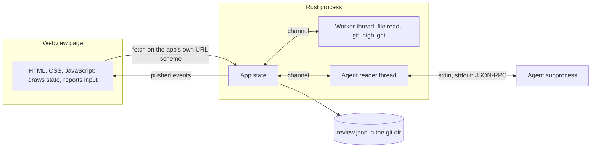

# Postil: design plan

Status: 2026-11-24. The UI layer is decided (a system webview through wry, core in Rust).
Milestones 0 to 4 are built, milestone 5 is under way, and milestone 6 (threads in worktrees)
is designed. Section "Decisions" lists what is settled and what is still assumed.

Mockups: https://claude.ai/code/artifact/68e1a720-a3d5-4d71-92d4-9acd76ea9d5e (private to the
owner until shared).

What comes after milestone 6 is designed in `docs/review-assist.md` (2026-11-25): reviewer
aids, the map of a repository, team memory and voice, as milestones 7 to 10. Where that
document changes a rule of this one (a second accent color, a second module with `unsafe`,
third-party JavaScript in the page, `mcpServers` no longer empty, a middle pane split into
diagram and code), it says so, and this
document is amended when each is built.

## The problem in one sentence

An engineer opens a local repository, reads code, attaches notes to line ranges, sends the
collected notes to a coding agent over ACP, watches the agent work, and checks the resulting
changes: in one fast native window.

Everything below traces back to that sentence. The app is a reader with a notes tray and an agent
panel. It is not an editor, not a terminal, and not a PR tool: it opens a draft pull request
from a thread's branch and reads back only that pull request's state.

## Not in scope

- Editing code by hand. The agent edits; the engineer reads and notes.
- A terminal, LSP, debugger, extensions, or plugin system.
- Remote review, or reading anything back from GitHub beyond a pull request's state. Postil
  opens a pull request from a thread's branch (section "Worktrees"); the owner moved that into
  scope on 2026-11-24.
- Two agents in one working tree. Each thread gets a worktree of its own (section
  "Worktrees", milestone 6), so threads run side by side.

## The loop

1. **Open.** `postil .` in a repository; or `postil` alone, which shows the welcome screen:
   Open Folder (`Cmd-O`, the native dialog), the recent projects, or a folder dropped on the
   window. A folder outside any repository gets an offer to make it one (`git init`). One
   window shows one project; opening another replaces it, and the project name in the sidebar
   leads back to the welcome screen. The file list comes from `git ls-files` plus untracked
   files that are not ignored.
2. **Read.** A file tree on the left, a fuzzy finder on `Cmd-P`, one code pane with syntax colors.
3. **Note.** Select lines (drag in the gutter, drag across the code text, or `v` then `j`/`k`),
   press `c` or right-click and choose Add note, type, `Cmd-Enter`. The note composer opens
   under the selected lines, inside the code, so the eyes do not move. The right-click menu
   also copies the selection (code only, never the line numbers) and its `path:lines`
   reference. `v`/`j`/`k` is not built yet.
   A note can also be on a whole file or folder: right-click its row in the file list and
   choose Add Note (or press `c` on a focused row). A dialog takes the text and saves the note to
   the tray (`Save note` or `Cmd-Enter`, `Discard` or `Esc`), just like the inline composer, so
   the engineer decides when and how to send it from the tray or its detail dialog.
   Asked for by the owner on 2026-11-24, as a modal over the window rather than the inline
   composer, which belongs to lines of code.
4. **Collect.** Notes list in the tray on the right, grouped by file. Clicking one jumps to its
   lines. Notes survive restarts.
5. **Send.** Pick an agent, press `Cmd-Shift-Enter`. The prompt preview shows the exact text the
   agent receives before it is sent.
6. **Watch.** The tray becomes the run panel: the agent's plan, its tool calls, its messages.
   Postil allows the agent's tool calls itself; only a question the agent asks stops for the
   engineer, answered in the note's or the run's dialog. `Esc` cancels the run.
7. **Verify.** The code pane switches to the changes the run made. Each note shows next to the
   lines that replaced it. Mark notes resolved, or write new notes on the changes and send them
   to the same session.

Step 7 closes the loop: the output of a run is reviewed with the same tool that produced the
notes.

## Look and feel

Inspiration: the Herdr desktop app. Read from its source (`herdrdev/herdr-app`, commit on
`master` as of 2026-11-22), its default look is: no title bar, inset window buttons, a 268 px
sidebar on a slightly lighter "chrome" color, panes as rounded cards (6 px radius, 6 px gaps,
1 px borders, an accent border on focus), Geist and Geist Mono fonts, and a low-contrast
`graphite` palette (`#17191d` background, `#d2d4d9` text, desaturated pastel syntax colors, a
steel accent `#a7b4c6`). We take the principles, not the pixels.

Rules for this app:

- **One accent, used rarely.** Steel blue for focus, selection, and the primary button. Amber is
  reserved for notes. Red appears only when the agent needs the engineer. The map has a second
  rare accent, `--map`, a muted orchid: `#d79ad0` in Graphite and `#a33a8a` in Paper, with a
  wash of the same color at 10% and 8% for the lines a node stands for
  (`docs/review-assist.md`, "The link shown in the code").
- **Cards on a canvas.** Three rounded panes with hairline borders and 8 px gaps. No toolbars, no
  icon rows, no status bar full of counters.
- **Resizable panes.** The file list (200 to 480 px) and the tray (280 to 720 px) are sized by
  dragging the divider in the gap beside them, or with the arrow keys on a focused divider;
  a double-click resets one. The file list does not fold: at 200 px its foot still shows the
  Settings button whole, and the owner asked on 2026-11-23 for no narrower list. The code pane
  keeps at least 420 px: in a narrow window the tray gives way first, then the file list. The
  map (View > Map, `Cmd-Shift-M`) opens inside the code pane, left of the code, 320 to 960 px
  wide with a third divider; while it is open the tray gives way first, then the map, then the
  file list. A window too narrow for the map at 320 px beside the code at 420 px shows one of
  them across the pane, and `Cmd-Shift-M` switches. Whether the map is open is kept for the
  window's session only. The widths are kept per Mac in `~/.config/postil/layout.json`
  (version 2 added the map's; a version 1 file reads with the map at 400 px), chosen by the
  owner on 2026-11-23 over per project; like `recent.json` it is a convenience, so a file that
  cannot be used counts as the defaults.
- **Code is the largest and brightest thing on screen.** Chrome text is dimmer than code text.
- **Two themes at launch:** Graphite (dark, default) and Paper (light). Each is a small palette
  of named colors, as in Herdr; a third theme is a new palette, not new code.
- **Focus mode.** `Cmd-\` (View > Focus Mode) hides both side panes, and the map. The code
  column centers at a readable width (at most 1100 px) and a single pill in the corner carries
  the open notes' count and Send, which leaves focus mode for the send step. Built in
  milestone 5. An open map waits for its end: `Cmd-Shift-M` leaves focus mode onto the map.
- **Fonts are bundled** (Geist, Geist Mono; SIL Open Font License). Bundling skips the system
  font scan at startup and makes the app look the same on every machine.

Motion: every animation is short and ends still.

| What | Duration | Curve |
|---|---|---|
| Hover and focus color | 80 ms | linear |
| Note composer opening under a line | 120 ms | ease-out |
| Side pane open and close (focus mode) | 160 ms | ease-out |
| Dialog, toast, the changes view and the prompt preview coming in | 120 ms | ease-out |
| Keyboard scroll (`j`, `k`, page keys, jump to note) | 120 ms | critically damped spring |
| Trackpad scroll | none added: follow the OS deltas exactly | |

The window draws only when something changed. An idle window draws zero frames. Every animation
is off when macOS's Reduce Motion is on (`prefers-reduced-motion`). The side panes ease only
while focus mode changes, never while a divider is dragged, which follows the pointer at once.
Keyboard scroll waits for `j` and `k`, which are not built.

## Architecture

A Rust core that owns all state, and a page in the system webview (WKWebView on macOS, through
wry) that draws it. Plain threads and channels for everything slow. No async runtime.



The boundary is narrow on purpose. The page asks for data with `fetch` on a custom URL scheme
(`postil://`), which the Rust process answers; no network socket is opened. The one exception
is the Usage dialog's account quotas, which `/usr/bin/curl` fetches while the dialog is open
(section "Usage"). Rust pushes
streaming events (agent updates) into the page. The page holds no state that matters: reloading
it loses nothing.

The frontend has no npm packages, no framework, and no build step: hand-written HTML, CSS, and
JavaScript modules compiled into the binary with `include_str!`. The fonts are compiled in too.

Why threads and not async: the app has three slow things (disk, `git`, one agent pipe). Each maps
to one thread with one channel. An executor would be one more moving part whose only job is to
schedule three tasks.

### Modules

| File | Holds |
|---|---|
| `src/main.rs` | Argument parsing; calls the library. |
| `src/shell.rs` | The window, the webview, the event loop, and the request thread that answers the page. |
| `src/site.rs` | The API the page calls over the URL scheme (`Site`), and the page's own files. |
| `src/app.rs` | `App` state and `App::update(Event)`. No drawing, no I/O: testable headless. |
| `src/repo.rs` | File listing, snapshots, and diffs by running the `git` binary. |
| `src/notes.rs` | `Note`, anchoring, and reading and writing `review.json`. |
| `src/anchor.rs` | `LineRange`, `Target` and `locate`: placing lines that move, for notes and the analysis. |
| `src/analysis.rs` | The diagrams, checking an agent's citations, and reading and writing `analysis.json`. |
| `src/thread.rs` | Threads: their worktrees, branches, `threads.json`, and freeing them. |
| `src/clone.rs` | One `clonefile(2)` call that clones a build folder: the crate's one `unsafe`. |
| `src/recent.rs` | The recent projects, `~/.config/postil/recent.json`, for the welcome screen. |
| `src/layout.rs`, `ui/panes.js` | The pane widths (the file list, the tray, the map), `~/.config/postil/layout.json`, and the rules for dragging and fitting them. |
| `src/settings.rs` | The settings, `~/.config/postil/settings.json`, and their rules. |
| `src/agents.rs` | The agent catalog, the login shell's `PATH`, and finding installed agents. |
| `src/memory.rs`, `src/memory/client.rs` | Team memory: finding hippius-mem, `doctor` and the trial vault's set up, on threads of their own; the MCP client of its server, which the thread named `memory` alone calls. |
| `ui/memory.js`, `ui/memory-tab.js`, `ui/memory-dialog.js` | Team memory on the page: its rules and polling, the tray's Memory tab and the run dialog's Memory section, and a memory's dialog. |
| `src/files.rs` | Atomic file writes and the configuration directory. |
| `src/dialog.rs` | The native Open Folder dialog (`NSOpenPanel` through objc2, no new crates). |
| `src/menu.rs` | The macOS menu bar through `muda`; its commands run in the page. |
| `scripts/bundle.sh` | Builds `target/release/Postil.app` with the icon from `assets/`. |
| `src/acp/wire.rs` | Serde types for the ACP messages the app sends and receives. |
| `src/acp/connection.rs` | Spawning an agent, the reader thread, requests, notifications. |
| `src/run.rs` | Runs: the prompt, the agent kept between runs. |
| `src/run/log.rs` | The run log: a run in memory and its file on disk. |
| `src/usage/ledger.rs`, `src/usage/quota.rs` | The usage ledger (`usage.jsonl`) and its totals; the providers' account quotas, probed on demand. |
| `src/highlight.rs` | tree-sitter highlighting: a file becomes lines of styled tokens. |
| `src/definitions.rs` | Jump to definition: an index from a name to where it is defined, built from the grammars' tags queries on a thread per open project (`index-definitions`). |
| `ui/index.html`, `ui/app.css`, `ui/app.js` | The page. `app.css` holds the two palettes as CSS variables; `app.js` holds the page's state and wires the views. |
| `ui/code-view.js`, `ui/file-list.js`, `ui/notes-tray.js`, `ui/context-menu.js`, `ui/welcome.js`, `ui/dividers.js` | One view each: the code pane with its selection, composer, and the map's stripes and chips, the file tree, the tray's notes and the send step, the right-click menu, the welcome screen, the pane dividers. |
| `ui/dom.js`, `ui/dialog-parts.js`, `ui/question-form.js` | Helpers the views share: `el()`, icons, the toast and two-click delete; the parts both dialogs draw; the question form. |
| `ui/settings.js`, `ui/settings-controls.js`, `ui/settings-dialog.js` | The settings dialog: its rules (tested with `node --test`), shared controls, and drawing. |
| `ui/wizard.js`, `ui/wizard-dialog.js` | The first-run startup wizard: its rules (tested with `node --test`) and 4-step dialog. |
| `ui/run.js`, `ui/run-panel.js` | The send step's and the run panel's rules (tested with `node --test`), and the run panel: `run-store.js` reads the runs, `run-tab.js` and `run-dialog.js` draw them. |
| `ui/status.js`, `ui/note-dialog.js` | Each note's status from its run (tested with `node --test`), and the note detail dialog. |
| `ui/usage.js`, `ui/usage-dialog.js` | The Usage dialog: its formatting rules (tested with `node --test`) and its drawing. |
| `ui/diagram.js`, `ui/diagram-view.js` | The map: its rules (layout through dagre, a node's state, search, pan and zoom arithmetic, the stripes and chips a file shows (`fileMarks`, `innermost`) and the node of a code line, tested with `node --test`), and the SVG, the keyboard, the node's dialog and following the code pane's line. |
| `ui/vendor/dagre.min.js` | `@dagrejs/dagre`, the map's layout, vendored with `dagre.LICENSE` and loaded by a script element when the map first opens. |
| `ui/definitions.js`, `ui/definitions-dialog.js` | Jump to definition: the name under a click and the history of places (tested with `node --test`), and the list a name defined more than once opens. |

### Data structures

Chosen from what is looked up, iterated, and changed, and how often.

```rust
/// A note the engineer wrote on lines, a whole file, or a whole folder.
struct Note {
    id: NoteId,                    // "N1", "N2": stable, shown in the UI and sent to the agent.
    path: RepoPath,                // Relative to the repository root.
    target: Target,                // What the note is on. Version 4 on.
    body: String,
    anchor: Anchor,                // Whether the target is still there.
    state: NoteState,              // Where the note is in the loop. From milestone 3 on.
    intent: Intent,                // Change, or Ask: a question answered read-only. Version 5 on.
    memory: Option<MemoryId>,      // The team memory remembered from it. Version 6 on.
}

enum Target {
    Lines {
        lines: LineRange,          // 1-based, inclusive.
        snippet: String,           // The selected text at the time of writing: the real anchor.
    },
    Path(PathKind),                // The whole file or folder at `path`.
}

enum Anchor {
    Found,
    Lost,                          // The snippet, or the file or folder, no longer exists.
}

enum NoteState {
    Open,
    Sent { run: RunId },
    Resolved { run: Option<RunId> }, // The run it was sent in last, so its dialog keeps it.
}
```

- **Notes** live in a `Vec<Note>`. A review holds tens of notes, so every operation is a scan.
  The line numbers are a cache: whenever the notes are read, `locate` keeps a note where its
  snippet still is, moves it to the only other copy, or marks its anchor `Lost`. It never picks
  the nearest of several copies (see "Notes and their status"). A file or folder note is found
  while its path is still a file or folder of that kind; a rename is not followed.
- **The target is an enum** because a file or folder note has no lines and no snippet, and
  optional fields would let a note have one without the other. Decided 2026-11-24 with the
  owner, over a separate kind of run that sends a path with no note: a note keeps every view
  (status, dialogs, reviews, follow-ups) working on it unchanged.
- **Anchor and state are two fields** because they answer two questions, decided 2026-11-22.
  A sent note whose text the agent replaced is the expected result of a run; an open note whose
  text vanished means the code drifted under it. The verify view shows these differently, and
  one enum would need a variant for every combination.
- **An open file** reaches the page as lines of tokens, each a style class and a slice of the
  text (`highlight.rs`). Read-only text needs no rope.
- **Visible lines only**: the code pane is a virtual list (`ui/code-view.js`) that builds rows
  only for the lines near the viewport, so a 50,000-line file adds no rows beyond those of a
  50-line one.
- **A run** is an append-only `Vec<Entry>` (message part, thought, tool call, tool call
  change, plan, permission request and answer, end), the same lines as its log on disk. A
  tool call's later changes are entries of their own, and the page folds them into the call:
  the log stays append-only, and the page fetches only the entries it has not seen. An
  execute call also keeps its command line and, once it finished, its exit code (run log
  version 5), so a run can show what it checked: agents report a failure differently, and
  Grok ends a command that exits non-zero as `completed`, with the code only in its
  `rawOutput`. Section "Runs" has the rest.
- **State on disk** is one file, `<git dir>/postil/review.json`, written atomically on every
  change. It sits inside the git directory, so it is never committed and needs no `.gitignore`
  entry. An agent or script can read and write notes by editing this file; the app reloads it on
  focus.

As built in milestone 2 (`src/notes.rs`):

- The file holds `{"version": 1, "notes": [...]}`; a note is `id` (`"N1"`), `path`, `lines`
  (`{start, end}`, 1-based, inclusive), `snippet`, `body`, and `anchor` (`found` or `lost`,
  optional on read because every read recomputes it). Unknown fields are refused, so a typo in
  a hand edit fails loudly instead of being dropped on the next write.
- **Every new field is a new format version.** A build refuses fields it does not know, so a
  milestone 2 build reading a file with milestone 3's `state` must fail on "version 2", not on
  "unknown field". Milestone 3 therefore writes version 2 and still reads version 1, with
  `state` defaulting to `open`. Milestone 4's resolved state is version 3.
- **Version 4** adds `target`: `"lines"`, `"file"` or `"folder"`, written for every note. A
  line note keeps `lines` and `snippet`; a file or folder note has neither, and a note whose
  fields do not fit its target is refused. An older file reads with every note on lines. The
  page adds one with `POST /api/notes {path, target, body}`; the path must be written as git
  writes it (no `.`, `..`, empty names or trailing `/`) and be a file or folder as `target`
  says now, or the request fails with 400. A symlink is a file wherever it points, as git
  tracks it and the file list shows it. A folder note's dialog lists the files the run changed
  below the folder, each with its counts, rather than their diffs, which the run's Changes
  view shows.
- **Version 5** adds `intent`: `"change"` or `"ask"`, written for every note. An older file
  reads with every note a change. `POST /api/notes` makes change notes only: an ask is made by
  `POST /api/run/ask`, which saves it only once its run starts, and a send or a preview that
  names one is refused (400). See `docs/review-assist.md`, "Ask without changing".
- **Version 6** adds `memory`: the id of the team memory remembered from the note
  (`mem_` and digits or capital letters, checked on every read), written only on a note that
  has one. An older file reads with none. Deleting the note leaves the memory. See
  `docs/review-assist.md`, "Postil writes memory".
- **Resolving a note** (`POST /api/notes/resolve?id=N1`) keeps the run it was sent in, so its
  dialog still shows what that run did; `POST /api/notes/reopen?id=N1` puts it back to sent in
  that run, or open when it was never sent. Only Reopen takes a note out of Resolved: a send
  naming a resolved note is refused (400), and a run that takes its turn after the note was
  resolved leaves it resolved, with that run. The tray lists resolved notes last, and the page
  offers no send for them.
- **Placing a note:** it stays where its snippet still is, or moves to the only other copy of
  the snippet; with several copies and none at its last lines its anchor is lost. The nearest
  copy is not taken: short lines such as `}` repeat, and the nearest is often the wrong one.
  Storing a few lines of context around the snippet would place more of these notes; that is
  a new field, so a new version, left for when lost notes on repeated lines prove common.
- **Adding a note:** the page sends the text it showed with the line numbers. When the file
  changed meanwhile, the note goes where that text is now (same rule), or the request fails
  with 409 and the draft stays in the composer.
- The Rust process keeps no copy. Every `api/notes` request reads the file and places every
  note. Only a change (add, delete, resolve, reopen, marking sent) writes the file, with every
  note at its current place; reading never writes, so the refresh on focus cannot overwrite a
  hand edit. A file that does not parse, has another version, or repeats an id is reported
  with its path and never overwritten.
- An add holds an exclusive lock on `<git dir>/postil/review.lock` from its read to its rename,
  so two app windows on one working tree keep each other's notes. A script that edits
  `review.json` without that lock can lose an edit made during an add.

### Working with the repository

The app runs the `git` binary. No libgit2, no gitoxide.

- File list: `git ls-files --cached --others --exclude-standard`.
- Snapshot before a run: `git add -A` and `git write-tree` against a temporary index file
  (`GIT_INDEX_FILE`). This captures the whole working tree, untracked files included, as one tree
  hash, and touches neither the real index nor the working tree.
- Changes after a run: the same snapshot again, then `git diff <before> <after>`.

No file watcher. The open file is re-read when a tool call that names it completes, when a run
ends, and when the window regains focus.

## ACP integration

ACP is JSON-RPC 2.0, one JSON object per line, over the agent subprocess's stdin and stdout. The
app is the client. Target: protocol version 1, the stable version. Version 2 has been a draft
since 2026-07-20 and changes how a turn ends; the app does not negotiate it.

### The messages the app uses

| Direction | Method | Used for |
|---|---|---|
| app to agent | `initialize` | Version and capabilities. The app advertises `fs` and `terminal` as false, and form questions (`elicitation.form`). |
| app to agent | `session/new` | `cwd` is the run's worktree. `mcpServers` holds hippius-mem in the stdio form when team memory is on and Ready, else it is empty; an agent that refuses the server is asked once more with none (docs/review-assist.md, "Agents get it"). The reply's model id (`models.currentModelId`, or Grok's `_meta`) is kept for the usage ledger. |
| app to agent | `session/prompt` | The notes. The response's `stopReason` ends the turn; its token counts (`usage`, or Grok's `_meta.usage`) and per-turn cost (Grok's `_meta.usage.costUsdTicks`) go to the usage ledger. |
| app to agent | `session/cancel` | `Esc`. Every pending permission request is answered `cancelled`, every open question `cancel`. |
| agent to app | `session/update` | `agent_message_chunk`, `agent_thought_chunk`, `tool_call`, `tool_call_update`, `plan`, and `usage_update` (context fill and the session's cumulative cost, for the usage ledger, never shown in the run panel). Other kinds, and kinds or enum values newer than the pinned schema, are ignored or read as "other". |
| agent to app | `session/request_permission` | Answered at once with the allow option (once, else always). With none, it waits for the engineer. |
| agent to app | `elicitation/create`, `session/create_elicitation` | A question as a form; the reply is `accept` with the form's values, `decline` (skipped), or `cancel`. Unstable in ACP; the first name is the schema's at the pinned commit, the second Claude's adapter's. A URL question is refused. |
| agent to app | `$/cancel_request` | The agent withdraws a request; an open question closes unanswered. |

The app advertises no file or terminal capability on purpose. It has no unsaved buffers, so the
agent's own file tools see the same bytes the app does. That removes five client methods, and
version 2 removes them from the protocol anyway.

The app does not set a mode (`session/set_mode`): the agent's default applies. Requests the
app does not serve (`fs/*`, `terminal/*`, anything newer) are answered "method not found",
and notifications it does not know (Grok's `_x.ai/...`, Claude's `_auth/...`) are ignored.
`src/acp/wire.rs` names the schema commit the types were written from.

Every permission request is allowed, whatever the tool call: the owner decided on 2026-11-23
that runs go without permission prompts, and that only the agent's questions stop for the
engineer. A request is allowed once when the agent offers that, else always; one with no
allow option waits, as before. Postil advertises form questions because Claude's adapter
otherwise sends its questions (`AskUserQuestion`) as permission requests, which auto-allow
would wave through unanswered (checked in claude-agent-acp at 130fbbc, `src/v1/acp-agent.ts`).
How Grok asks a question is not checked yet.

### The prompt

One text block, then one `resource_link` per file with line or file notes. Every agent must
accept both block types, so no capability check is needed.

```text
These are review notes an engineer wrote while reading this repository.
Address every note. Change nothing the notes do not ask for.
When you finish, list each note id with one line on what you did.
Then end your reply with a report for the engineer who reviews your changes: one JSON object
in a code block fenced as json, the last thing in your reply. [...]

[N1] src/acp/connection.rs:37
>     let reply = rx.recv().unwrap();
recv().unwrap() panics when the agent exits mid-request. Return
AcpError::AgentExited instead.

[N2] src/acp/ (folder)
Split this module by message kind.

[N3] README.md (file)
Document the --bench flag.
```

The quoted snippet travels with the note because line numbers go stale the moment the agent
edits the file. A file or folder note quotes nothing: the agent reads the path itself. A folder
gets no `resource_link`, because agents read a link as a file; the path in the text names it.
A file or folder that is gone says so under its heading, as lost lines do. The send step lists
the linked files as `GET /api/run/preview` returns them (`files`).

The paragraph that asks for the author's report (`report::ASK`, shortened above) gives
its shape in words, never as an example block, which a reply quoting the prompt would hand
back. As a run of notes or a follow-up ends well, Postil reads the report from the reply and
logs it with the end as a `report` entry, or a `noReport` entry saying why there is none
(run log version 6; `docs/review-assist.md`, "The author's report"). A follow-up's prompt,
the engineer's words alone, ends with a one-line reminder, or with the whole ask when its
thread started before reports.

### Runs

Built in `src/run.rs` and `src/run/log.rs`, with the API the page calls (`src/site.rs`):

| Route | Does |
|---|---|
| `GET /api/run/preview?notes=N1,N2` | The prompt's text, exactly as the agent receives it. |
| `POST /api/run` `{notes, agent?}` | Starts a run with the notes, in that order; the agent is the settings' one unless named. |
| `GET /api/run?after=N` | The latest run, with its entries from number `N` on, and its notes and prompt only when `N` is 0: they never change; `null` when there is none. |
| `GET /api/run?id=R2&after=N` | One run: this window's when it is one of its threads' latest, else read from its log; `after` as above, 0 when left out. |
| `GET /api/runs` | `{runs, live}`: the ids of the runs on disk, newest first, and this window's runs under way, oldest first, each `{id, thread}`. |
| `POST /api/run/permission` `{run, request, option}` | Answers run `run`'s permission request with an option the agent offered (one with no allow option, which Postil does not answer itself). |
| `POST /api/run/question` `{run, request, content}` | Answers run `run`'s question with the form's values, or skips it (`content` `null`). |
| `POST /api/run/cancel` `{run}` | Cancels run `run`; open permission requests are answered `cancelled`. |
| `POST /api/run/ask` `{note}` | Asks the question `note` (a new note, as `POST /api/notes` takes one) of the settings' agent, read-only, in a new thread that only reads; saves it as an ask, sent in that run, only once the run has its place, and answers every note. |
| `GET /api/run/uncommitted?file=<path>` | The engineer's changes since the last commit, which a new thread does not see, and whether the file is among them, as the preview says for its notes. |

- **Each thread keeps its agent between its runs**, with its session, so a follow-up
  reaches the same conversation: the owner chose this on 2026-11-23 over a fresh agent per
  send. It is replaced when a run names another agent or command, let go when the window
  needs its place (section "Worktrees", "Threads"), and stopped when the project closes, the
  agent exits, a turn fails (its session may be broken), or its thread ends. A send starts a
  new thread in a new worktree, with a fresh agent.
- **One run at a time per thread**, threads side by side: a follow-up or a review while the
  thread's run goes on is refused (409), and a live run holds an exclusive lock on its
  thread's `threads/<id>.lock`, so another window is refused there too. At most 3 runs are
  live in a repository (section "Worktrees", "Keeping the disk in bounds"). A send of a note
  that a run of this window under way carries is refused (400): notes are marked sent only
  once the agent takes the turn, so the note still reads as open while its agent starts.
  Another window does not know this window's runs, and can still send such a note in those
  seconds: accepted, as two windows on one working tree are rare and the lock files carry no
  notes.
- **Stop** asks the agent to cancel (`session/cancel`), and answers its open permission
  requests `cancelled`, as well as any that arrive until the turn ends. An agent that is
  still starting is killed instead, and the run ends at once. A second Stop from 3 s after
  the first kills an agent that did not stop, so a hung agent never holds the working tree;
  sooner, it is the same request (a double click).
- **Permission requests and questions** are numbered together by `acp::Agent`, which keeps
  the only table of open ones; the log records each and its answer by that number. A
  permission request is answered as it is logged (auto-allow); a question waits for
  `POST /api/run/question` `{request, content}`, `content` the form's values or `null` to
  skip. Stop answers open questions `cancel`, and an agent's withdrawal closes one.
- **Starting** happens on a thread of its own, because it can take minutes. Each start-up
  step (`initialize`, `session/new`, and `session/set_config_option` when a model is set) may
  take 120 seconds, and Stop ends the wait. The `gemini` CLI 0.40.1 (Gemini's agent before
  `agy`), not signed in, never answered `initialize` (it waits for a browser sign-in), checked
  2026-11-23; the run then fails with the hint to run the agent in a terminal.
- **The model** of the slot the run comes from (section "Settings") is set right after
  `session/new` with `session/set_config_option`, before the prompt, and only when the agent's
  model select offers it: an agent may take an id it does not know and run another model
  without a word. A model it does not offer, or any model for an agent with no model select,
  fails the start with a message that names the model and the ones offered, so the engineer
  picks another in Settings. "Agent default" (no model) sets nothing. A follow-up goes on with
  the agent kept from the run it follows, on the model that agent runs, even when the slot's
  model changed since: changing the settings must not drop a live conversation or switch its
  model (decided 2026-11-26). Only a fresh agent, for a new send or when no live agent is
  kept, takes the settings' model.
- **The log** is `<git dir>/postil/runs/R<n>.jsonl`: a header line (agent, notes, prompt,
  start time), then one line per entry, appended as it happens. The owner chose on 2026-11-23
  to keep runs on disk. Creating the file claims the id, so two windows never share one. After
  a restart the newest readable log is shown; one without an end reads as unfinished (the
  app quit during it, or another window runs it). Lines are decoded one by one, so a torn
  write spoils only its line, which is reported; an unreadable newer log is skipped and
  named. Nothing is synced: a crash costs at most the last lines. Run log version 7 adds
  `readOnly` to the header of every run in a thread that only reads (an ask and its
  follow-ups: no snapshot, no report, every tool call but a read refused), and the `undone`
  entry, logged before the end of a read-only run whose edits Postil put back, which becomes
  the run's problem after a restart too. Older logs read as runs that may change files. Run
  log version 8 adds `analysis: {kind, of, nodes}` to the header of an analysis run
  (docs/review-assist.md, "An analysis run"), which carries no notes and is read-only, and the
  `noAnalysis` entry, logged with the end of one whose turn ended well and stored nothing,
  which becomes its problem. An analysis run's log is kept when notes are deleted: its
  diagrams name it. Older logs read as no analysis. Run log version 9 adds `remember: {of}`
  to the header of a memory draft (docs/review-assist.md, "Postil writes memory"): a read-only
  run in the thread whose latest turn is `of`, whatever the thread's mode, never the latest run
  of the Run tab, whose reply ends with the draft. Older logs read as no draft. Run log version
  10 adds `memory` to a finding of the `findings` entry: the id of the team memory the finding
  names, one the review's memory block held (docs/review-assist.md, "Review checks against
  memory"), and absent otherwise. Older logs read as findings that name no memory.
- **Notes** are marked sent, with the run's id, once the agent shows it took the turn: its
  first update, a permission request, or a stop. A run that fails to start, or whose prompt
  the agent refuses, leaves them open. `review.json` is version 2 for this field, `state`,
  always an object: `{"kind": "open"}` or `{"kind": "sent", "run": "R3"}`. Version 1 files
  read with every note open.
- **A run goes with its last note.** Deleting a note deletes the log of every run none of
  whose notes is left (asked by the owner on 2026-11-23). A run with other notes keeps its log;
  this window's live run keeps it until a delete after it ends. Run numbers are never given
  again: the highest one used is kept in `runs/active.lock`, so a page that read R5 never
  takes a new run for it. Note ids still can be (a deleted highest note's number is given
  again): a run that keeps other notes lists the new note under the old id, and shows the
  old reply's line for it. Never reusing note ids needs the next id in `review.json`, a new
  format version; not done yet.
- **The page** is told about changes by a script call (`window.postil.runChanged()`) and
  fetches the entries it has not seen. Calls are coalesced: none is queued while one is
  pending, since an agent streams its reply in many small parts.
- Closing the project or quitting kills the agent's process group (`npx` leaves `node`
  running), a starting agent's too. A run cut short this way reads as unfinished.

### Notes and their status

The tray shows each note with where it is in the loop, worked out in the page
(`ui/status.js`) from the note's sent mark and its run: the live run from the run panel, any
other read once by id (`GET /api/run?id=R2`) and kept, since a finished run does not change.
One source of run state, the log, so the Rust process has no second summary to keep in step.

- **Statuses:** Open; Starting, Working (or Stopping) and Needs you while its run is live;
  then Addressed when the agent's reply has a line for the note (`N3: ...`, which the prompt
  asks for), No word when it has none, Stopped, Failed, or Unfinished. A note whose turn the
  agent refused is open again. The tray groups them: in the live run, open, and done, newest
  run first.
- **The note detail** (`ui/note-dialog.js`) opens from a card: the note, its lines, what the
  agent said about it, and the run's history for it (tool calls on its file, plan steps that
  name it). Show in code closes it and scrolls to the note. For a folder note the history and
  the diffs are those of every file below the folder, and Show in files opens the folder in the
  file list (`ui/note-place.js`, `covers`).
- **Sending one note:** the arrow on a card, or Send in the detail, sends that note alone to
  the default agent at once and stays on the notes; Shift-click opens the send step with only
  it ticked. Decided with the owner on 2026-11-23. A run that starts no longer takes the tray
  to the Run tab unless it came from the send step; one that needs the engineer still does.

### Reviews

A Review button in a run's dialog, and in the dialog of each of its notes, sends the run's
work to the settings' reviewers in order (`src/review.rs`, `POST /api/run/review {of}`). The
work is the run's prompt, its reply, and the diffs its finished edits made. Decided with the
owner on 2026-11-23:

- **Every reviewer but the last proposes, read-only.** Postil rejects its tool calls but reads,
  searches, fetches and thinking, and its prompt says not to change files. That stops only
  the calls an agent asks permission for; an agent set to edit without asking is caught when
  its turn ends, by the edits its run reports, and the review stops there. An edit made
  through a command reports none. The reviewer ends its reply with its findings as a JSON
  array fenced as json, which Postil reads and logs as the run ends; the findings are
  numbered `F1`, `F2`, ... across the chain. The prompt gives the format in words, not as an
  example block, which an agent quoting it would make read as findings.
- **The last of two or more judges.** It gets every finding, accepts or rejects each, makes the
  accepted changes, and ends with one line per finding (`F1: accepted - ...`). A single
  reviewer only proposes.
- **Each stage is a run,** marked in its header with the run it reviews and its place in the
  chain, started with a fresh agent when the one before ends well: a reviewer never inherits
  the reviewed agent's conversation. That replaces the agent kept for follow-ups, and a send
  after a review starts a fresh agent too, never a reviewer's. A stage that fails or is
  stopped ends the review, and a send ends one between stages. A review marks no note sent.
  The run log is version 2 for the review header field and the `findings` entry; version 1
  logs read as runs of notes.
- **Findings live in the work, not as notes or runs of their own.** The Run tab lists only runs
  of notes; a run's dialog has a Review section with a card per reviewer (it opens that
  reviewer's run) and a card per finding with its verdict (it opens the finding whole), and a
  note's dialog shows the findings about that note, in full.
- **With team memory on, every stage checks the work against it.** The first stage's start
  recalls memories for the reviewed run's prompt and changed paths, and every stage's prompt
  carries them as reference data written by teammates; a finding may name one, which its card
  opens (docs/review-assist.md, "Review checks against memory").

### Follow-ups

A run's dialog ends with a box for a follow-up: what the engineer asks next about the run's
work (`POST /api/run/follow {of, text}`, `Runner::follow_up`). Decided with the owner on
2026-11-23: a follow-up is a new run, threaded under the run it follows.

- **The same conversation when it still exists.** The follow-up goes to the agent that ran the
  thread's latest run. When the kept agent is that agent and ran that run, it gets the
  engineer's words alone, as the next prompt of its session. Otherwise (the agent exited, a
  review or another send replaced it, or Postil restarted) a fresh agent gets the thread's
  earlier prompts and replies first, then the words, with the edited files linked; the
  follow-up's dialog says so.
- **A thread does not fork.** A follow-up of a run another run already follows is refused
  (400, naming the run to follow up instead): two windows, or a stale page, would otherwise
  make two threads that each leave the other's work out of a fresh agent's prompt.
- **A follow-up carries its thread's notes** and marks none sent: it goes with them when the
  last is deleted, and a note's status shows the follow-up only while it runs.
- **The header** holds `followUp: {of, text}`, the run it follows and the engineer's words, so
  the dialog shows the words and not the longer prompt a fresh agent got. The run log is
  version 3 for it; older logs read as before.
- **One card per thread.** The Run tab lists the run of notes, with the status of the thread's
  latest run; the dialog shows that run, then each follow-up (the words, the steps, the
  reply), its Review section, and the box. Review reviews the first run's work, and a review
  of a follow-up is refused, as the page would have nowhere to show it.

### The changes view

A run's dialog has a Changes button: the code pane then shows what the run, or its whole
thread, changed (`ui/changes-view.js`, `GET /api/run/changes?from=R1&to=R3`). Decided with the
owner on 2026-11-23: snapshots are git trees, and the view is a unified diff per file.

- **Snapshots.** Postil takes one before each run (before the agent gets the prompt) and one as
  its turn ends, and logs each as a `snapshot` entry with its point (`before`, `after`) and the
  tree's id (`Repo::snapshot`, run log version 4). Since 2026-11-24 a run in a thread logs a
  commit on its thread's branch there instead, and the tree snapshot below is taken only of a
  worktree with no commit after its run (section "Worktrees", "Commits"); the field keeps
  its name, `tree`, since `git diff` takes either. A proposing reviewer, which may not edit,
  takes none. A snapshot is every tracked file and every untracked file that is not ignored,
  written as a tree through Postil's own index, `<git dir>/postil/snapshot/index`, kept between
  snapshots. It starts from a copy of the real index, and again whenever the two track
  different ignored files (one force-added, or one taken out of git and added to
  `.gitignore`), which `git add --all` cannot reconcile. The engineer's index, branch and
  stash are left alone. A snapshot that cannot be taken is the run's problem, and the run goes
  on without a changes view.
- **What it costs.** A snapshot runs `git add --all` and `git write-tree`, under the runner's
  lock before the run (so on the window's thread, which waits) and on the agent's reader
  thread after it. git hashes only the files whose stat data changed since the last snapshot:
  tens of milliseconds on a medium repository. The first snapshot of a working tree hashes
  every untracked file in full, which a reviewer measured at 3.5 s with a 200 MB untracked
  file. `git add` runs the repository's clean filters, so git-lfs copies each changed file
  into `.git/lfs`. The trees and blobs are objects no ref holds, so `git gc` may prune them
  after its prune period (two weeks by default); the view then reports git's error.
- **The diff** is `git diff` between the snapshot before the first run and the one after the
  last, renames shown as a removal and an addition. Its options fix the format whatever the
  engineer's git config says (prefixes, path quoting, blank context lines, no textconv). A
  run with no snapshot after it (under way, ended before the agent took the turn, or its
  snapshot failed) is compared with the files as they are now, and the view says so. A forced
  stop takes the snapshot after the agent is killed. Runs logged before snapshots have no
  Changes button.
- **The view** shows each file with its hunks and line numbers on both sides, and each note
  beside the changed line its lines end on. A click on a line number of the new side opens
  that file at that line with the composer: the next note goes on the change itself, and a
  follow-up sends it. A file draws its first 400 lines, and the rest on a click. Esc, the
  header's esc, or opening a file gives the pane back.
- **Walkthrough order.** A single run whose author's report names steps opens in
  Walkthrough order instead, with each hunk's rating and the review's findings beside their
  lines; the 400-line limit is then per step (`docs/review-assist.md`, "Guided walkthrough and
  risk"). A thread of several runs keeps the order above.

### Worktrees

Milestone 6, built. Decided with the owner on 2026-11-24. Two agents in one working tree
overwrite each other's edits, so each thread (a run of notes with its follow-ups and reviews)
runs in a git worktree of its own, on a branch of its own. The engineer's working tree is
never an agent's working directory; changes reach it only through Apply or a merged pull
request.

Built (`src/thread.rs`, `src/clone.rs`, `src/run/room.rs`, `src/disk.rs`, `src/run/pull.rs`,
`src/github.rs`): a worktree and a branch per thread, the record, commits as snapshots, the
cloned build folders, Apply and Discard, a runner per thread with its locks, the cap of 3 live
runs, `git worktree lock`, the startup sweep, the cap of 15 worktrees, the free-space floor and
eviction, pull requests, the warning about uncommitted changes at send, and sparse-checkout
patterns.

#### Threads

- **One worktree per thread, made at send.** A saved note has none. Notes sent together share
  one, and the thread's follow-ups and review stages run in it.
- **A runner per thread.** Each thread has its own agent and session, kept between its runs
  as section "Runs" describes for one. The session's `cwd` (`session/new`), the prompt's
  `resource_link`s, and the paths in the run log are all in the thread's worktree, never in
  the engineer's working tree. A follow-up or a review stage uses only its thread's agent.
  A window keeps at most 3 agents, running or idle: before a fresh one starts, the idle one
  used least recently goes, and its thread's next follow-up tells a fresh agent the thread
  (section "Follow-ups"). An idle agent is a process of a few hundred MB kept only for that
  follow-up. A busy thread keeps its agent, so a review between two stages, busy with no
  run, can leave a window one agent over until a later launch.
- **Locks.** Run logs, notes, and the run-number counter stay in the project's git dir.
  `runs/active.lock` is held only while a run is created: taking its number, counting the
  live runs, and taking its thread's lock are one step across windows, so two windows never
  both see a place under the cap. One run at a time per thread is a lock of its own,
  `<git dir>/postil/threads/R<n>.lock`, held for the run; a lock held is a live run, which
  the count reads by trying each one. Ending a thread, or forgetting it with its last note,
  holds its lock, so no window's agent works in a worktree being freed; another window's run
  there refuses the ending (409) and keeps a forgotten thread for the next delete. An ending
  counts as a live run while it lasts (seconds for an Apply on a large repository), which a
  count in another window can read: accepted, since telling the two apart would read the
  record under `runs/active.lock`. A count at the cap is taken again for up to 200 ms
  before it refuses, because a lock released a moment ago stays held in a process this one
  forked until it runs its program. `threads.lock`
  serializes, across windows, every change to the record. The window marks a
  worktree its start thread is still making, and counts it as a run under way: no commit,
  run or ending touches a half-made checkout. Eviction takes an idle thread under its lock
  too, as an ending does.
- **`git worktree lock`** for a worktree's whole life (`git worktree add --lock`), so the
  engineer's `git worktree remove` and a `git worktree prune` leave it alone. Postil frees a
  worktree by deleting git's record of it, the lock with it, so it never unlocks one. Chosen
  2026-11-25 over locking only while a run is live, which the design said before: that takes
  two git calls per run and a sweep to unlock what a crash left locked, and guards less.
- **The record** is `<git dir>/postil/threads.json` (version 2), one entry per thread: `id`,
  its first run; `path`, the worktree's absolute path; `branch`; `fork`, the commit it starts
  from; `base`, the branch `HEAD` was on at send; `tip`, the last commit Postil made or found,
  before or after a run; `lastRun`, when its latest run started, in milliseconds since the
  Unix epoch; `skipped`, what the worktree was not given; and `state`: `open`, `evicted`,
  `applied` or `discarded`; and `pullRequest`, once one is opened, with its `url` and `state`
  (`open`, `merged` or `closed`) as last read; and `mode`, `work` or `read` (an ask's thread,
  which clones no build folders and cannot be applied, reviewed or opened as a pull request).
  This is version 4. Version 1 had no `lastRun` and no evicted state, neither 1 nor 2 a pull
  request, and none before 4 a mode; all are still read, version 1's threads as having run at
  time 0, every older thread as one that works, and written back as version 4. A change reads
  the file,
  changes one thread and writes it whole, under `threads.lock`; a new thread is written
  before `git worktree add`, so a crash leaves a
  record pointing at whatever was made. Run logs stay append-only, so this file holds what
  changes. A file that cannot be read or parsed is reported and never written over.
- **Based on `HEAD`, not on the engineer's uncommitted edits**, as Cursor, Codex and Claude
  Code do: those edits would otherwise land in the pull request. The fork commit is `HEAD` at
  send. When the checkout has uncommitted changes, the send step says the thread starts from
  the last commit and does not see them; when a noted file is among them, it adds that the
  note's lines may not match, or that the agent may not have the file. The preview reply
  carries both: the count of entries `git status` lists (an untracked folder is one entry,
  ignored files none), and the linked files among their paths, a rename's source included,
  so the step names no file of the engineer's that it does not need to. The status runs on
  the request thread at each tick, with `--no-optional-locks` so it never takes the
  engineer's index lock; one that fails leaves the count unknown, and the step says it could
  not check rather than showing a clean tree. A folder note is in the count only: the noted
  files are the linked ones. A repository with no commit cannot send (422), and the message
  says it needs one commit first. A detached `HEAD` sends too, with no base branch: the
  thread can
  be applied but not opened as a pull request.
- **The branch** is `postil/r<n>-<slug>`, the slug from the first note's text, lowercased to
  `[a-z0-9-]`, at most 40 characters, and `postil/r<n>` when nothing is left. Built from
  those characters only, with no dash at either end, it is always a name
  `git check-ref-format` accepts. A branch of that name that exists already (two linked
  worktrees of one repository number their runs apart) fails the run with git's message.
- **Where:** `~/.postil/worktrees/<repo>-<id>/r<n>`, `<id>` the first 8 hex digits of a hash
  of the repository's canonical path, so two clones with one name stay apart. The record holds
  the path, so nothing recomputes it. A home folder per tool is what Cursor
  (`~/.cursor/worktrees`) and Codex (`~/.codex/worktrees`) use. Inside the repository, as
  Claude Code does, would need a `.gitignore` entry and would put the worktrees in Postil's
  file list. A repository on another volume than the home folder gets its worktrees in
  `.postil/worktrees/` at that volume's root, so clones stay on one volume, unless the
  repository is that volume's root, where the folder would be inside it. Paths are
  resolved (`/tmp` is `/private/tmp` on macOS): an agent reports the paths the system gives
  it, and Postil strips the worktree's path from them.
- **Making it:** `git worktree add -b <branch> <path> <fork commit>` on the agent's start
  thread, before the agent starts there, with no hooks (`post-checkout` may install or build),
  then `git submodule update --init` when `.gitmodules` exists. When the engineer's checkout
  is sparse, the worktree is too, with the same mode (cone or not) and patterns, and the
  files they leave out are never written: in a large monorepo the checkout is the slow part,
  and the disk. Git does this itself: `git worktree add`, run in the engineer's working tree
  as Postil runs it, copies that tree's sparse-checkout settings to the new one (git 2.36
  and later; tested with git 2.56, cone and not). Postil has no code for it, and a test
  pins the behavior. An older git checks every file out. An agent may write outside the
  patterns (a new test or doc): Postil's commits stage with `git add --all --sparse` (git
  2.34), since without it git refuses such a file and every later commit of the thread
  fails. A worktree that cannot be made
  fails the run and takes the thread out of the record: its branch name may belong to a
  thread of another working tree of the repository, which deleting this thread's note would
  otherwise delete.

#### Warm build folders

After the worktree is made, Postil clones the ignored top-level folders of the engineer's
working tree into it: `target/`, `node_modules/`, and the like.

- **Which:** `git ls-files -z --others --ignored --exclude-standard --directory`, keeping
  entries that are one path component ending in `/`. Symlinks are skipped, and so is a folder
  holding `pyvenv.cfg`: a Python virtual environment names its own absolute path, so a clone
  would install into the engineer's. So is a folder the worktree does not ignore
  (`git check-ignore`), which an ignore rule the engineer has not committed yet makes: the
  worktree's next commit would take the whole folder in.
- **How:** one `clonefile(2)` per folder. Measured on 2026-11-24 with Postil's own 4.4 GB,
  193,000-file `target/`: 3 s and no disk used until a block changes, where `cp -c -R` took
  34 s; cargo 1.100 then built in the clone at its new path with nothing recompiled. Symlinks
  inside a cloned folder stay links, cross-volume ones included (tested the same day). The
  call is the crate's one `unsafe` code (`src/clone.rs`): the crate forbade `unsafe` until
  then, and the owner allowed this one module on 2026-11-24 over the 34 s of the safe route.
  The man page discourages `clonefile` on directories and points to `copyfile(3)`, so a
  folder whose clone fails is tried once with `cp -c -R` (which copies through `copyfile`,
  cloning file by file where it can), then skipped, and the thread names what it skipped in
  its record and its dialog. A volume that cannot clone at all (`ENOTSUP`, `EXDEV`: HFS+,
  exFAT, a network share) gets no copy: a full copy of a build folder on every send costs
  the disk the clones save. A folder the engineer is building into
  at that moment can be cloned half-written; cargo's fingerprints catch most of that, and
  `cargo clean` in the worktree fixes the rest.
- **Rejected:** a shared `CARGO_TARGET_DIR`. Cargo's lock on it makes concurrent builds wait,
  and every tree writes the same `target/debug/<name>`.

#### Commits

After each turn of a run that may edit (a run of notes, a follow-up, a judging reviewer),
Postil commits everything in the worktree: `git add --all`, then `git commit --no-verify
--cleanup=verbatim` with the engineer's git identity, no hooks (`core.hooksPath` emptied:
`--no-verify` alone still runs `prepare-commit-msg` and `post-commit`), and no signing: the
commit runs on the page's request thread, where a signer asking for a passphrase would hold
every request, and it is Postil's snapshot, not the engineer's commit. The message says what
was asked:
`Postil R3: notes N1, N2` and the prompt, `Postil R4: follow-up of R3` and the engineer's
words, or `Postil R5: reviewer 2 of 2 on R3`. A proposing reviewer may not edit and takes no
snapshot: if it leaves `git status --porcelain` non-empty, or moves the branch (it
committed), its changes are undone (`git reset --hard` to the tip, `git clean -d`, ignored
files kept) and the review stops, so neither the next commit nor Apply takes them. When the
agent committed its work itself, nothing is left to add and Postil makes no commit. Before
every run of an open thread, a proposer's included, anything left in the worktree since the
last commit (a commit that failed, a hand edit) is committed first, as `Postil: work left in
the worktree before R4`, and a commit the engineer made there becomes the tip: undoing a
proposer's edits goes back to that point, so it never takes the engineer's work with it.
When that commit fails before a proposer, the stage does not start. Every commit Postil
makes or finds becomes the thread's tip, before a run as after it: a run that then never
starts takes no snapshot after it.

- **Snapshots are commits.** Before is the branch tip at the start of a run, after is the tip
  at its end, both logged in the existing `snapshot` entry (`git diff` takes a commit id as
  well as a tree). A thread run never snapshots the engineer's working tree. During a run, the
  changes view compares with the worktree's files as they are now.
- **A commit that fails** (a missing identity) is logged on the run with git's message, and
  the worktree stays dirty. The after point is then the worktree as it is, and ending the
  thread asks (below).

#### Ending a thread

Three things end a thread, each one of the engineer's clicks:

- **Apply** writes the changes between the fork commit and the tip into the engineer's working
  tree, uncommitted. First the safety check below; then
  `git diff --binary --find-renames <fork> <tip>`, with the options `Repo::diff` pins against
  the engineer's git config, piped to `git apply --whitespace=nowarn`. Plain `git apply`
  changes files only and is atomic ("fails the whole patch and does not touch the working
  tree when some of the hunks do not apply", `git help apply`), so a patch that does not fit
  is refused (409) with the files that clash, and the thread stays open. `--3way` was
  rejected because it stages its result, and Postil leaves the engineer's index alone
  (section "The changes view").
- **Discard** ends the thread with nothing applied.
- **A merged or closed pull request** (built, `src/run/pull.rs`, `src/github.rs`). Open pull
  request, in the thread's dialog, does not end the thread. It is never automatic: it writes
  to GitHub. On the request thread it checks, with no network, what would make the pull
  request wrong, and refuses (409) saying why: a branch outside `postil/` (the record is a
  file a hand edit can change); no base branch (the thread started from a detached `HEAD`);
  a base branch with no remote (the remote and branch it tracks, else its name on
  `origin`); a base branch not on that remote, as this repository last fetched it; commits
  the thread starts from that the remote's base branch lacks, the first 10 listed, since the
  pull request would show them; work Postil did not commit (the safety check). Then, on a
  thread of its own, it pushes the branch to the branch of the same name on the remote, and
  runs `gh pr create --draft --base <base> --head <branch>`, and records the URL in the
  thread. The title is the first line of the first note. The body is the notes still there,
  each with its place and text, cut at 60,000 characters (GitHub refuses over 65,536):
  never the prompt, which quotes the code and could carry a secret a note asks to remove.
  The push and `gh` run with the login shell's `PATH`, so the engineer's credential helpers
  are found, and the push runs their `pre-push` hook, unlike Postil's own commits: it is
  their push to their remote, which a hook may guard. Off the request thread because a hook
  can take minutes, and the page's Stop and answers go through that thread. It holds the
  thread's lock from its checks until `gh` is done, as a run does, so no run, ending,
  forgetting or eviction in any window changes the branch or the record under it; the
  dialog disables Apply and Discard meanwhile, and the project counts as busy. When GitHub
  has a pull request for the branch already that the record lacks (a quit, a failed write,
  another window), the URL in gh's "already exists" message is recorded. What this window is
  doing (opening, reading the state) or why it failed is kept in memory only, shown in the
  dialog, and lost with the window, so a crash leaves no thread marked as opening; the
  engineer asks again. Postil reads the state (`gh pr view <url> --json state`) when the
  window regains focus, for every pull request not merged of the threads the page has read
  (a closed one may be reopened), never on a timer. Merged or closed, the dialog says so and
  that Discard ends the thread: its changes reach the working tree through the base branch,
  not through Apply. Only a line of gh's output naming a pull request (`/pull/`) is kept as
  the URL, and its link opens in the default browser (`open`): the page itself never
  navigates away. Not supported: a fork (pushing to one remote and opening the pull request
  on another); with several remotes and no default set, gh refuses rather than guessing.

**The safety check:** the worktree has no uncommitted change outside ignored files, and its
branch is at the commit Postil made last or past it. Past it is a commit the engineer made
in the worktree, which is theirs to keep: Apply takes it, and it becomes the tip. Discard
leaves the tip at Postil's commit, so the branch, which then holds the only copy, is kept
when the thread's last note goes (below). Failing
either means something Postil did not make, and would lose, is there: Postil shows it and
asks, and writes nothing and deletes nothing until the engineer answers. Ignored files are
not checked: they are build output, and every worktree holds cloned ones. Built so far:
Postil refuses (409), naming what is there and the worktree's path, so the engineer commits
it there (and it is kept) or removes it; an answer in the dialog that ends the thread anyway
is not built. A thread whose run is under way in any window, whose review is between two
stages, or whose worktree is being made is not ended either (409). Deleting a thread's last
note runs the same check; a thread that fails it stays, with its worktree and branch, until
the next delete. The check also wants the thread's branch checked out in the worktree: a
commit made with `HEAD` detached, or on another branch there, is in no ref the free keeps.
A branch past Postil's commit (committed to in the worktree, after the thread ended, or
kept by a Discard) is the engineer's work: it stays, and the thread is forgotten, so no
delete is refused for good. The branch goes only while it names Postil's commit, checked
and deleted in one git call (`update-ref -d <ref> <tip>`). A worktree being made, after a
Stop or a close too, keeps its run live, and with it the run lock, until git is done.

**Only what Postil made is deleted.** The record is a file a hand edit can change, so a
worktree, or git's record of one, is freed only when its path is
`<base>/worktrees/<repo>-<id>/<folder>` for this repository, whether it is on disk or not,
and its trash is found from the base, never from the recorded path. The `<id>` must be eight
hex digits, but is not checked against the hash: a Rust release may hash a path differently,
and every older thread would then fail. A folder on disk must have a `.git` that names a
worktree record of this repository; Postil writes those pointers absolute
(`worktree.useRelativePaths=false`) and reads relative ones too. Only branches under
`postil/` are deleted.

**An ended thread frees its disk at once:**

1. Stop the thread's agent, once Apply succeeded. The worktree stays locked in git: step 2
   deletes git's record of it, and the lock with it.
2. Rename the worktree into `trash/` beside `worktrees/`, as `r<n>-<pid>-<count>` (instant on
   one volume), delete git's record of that one worktree (`<common git dir>/worktrees/<name>`,
   as `git worktree prune` would; a global prune would also drop the engineer's worktrees on
   a disk not mounted), and delete the folder on a background thread: 193,000 files take
   seconds. Never the macOS Trash, which keeps the disk in use. Opening the repository again
   finishes a delete that a quit cut short. The thread is marked ended before this step, so
   a free that fails leaves an ended thread, whose worktree goes with its last note, never an
   open one whose changes were applied already, which a second Apply would write again.
3. Keep the branch. It costs no real disk, the changes view reads its commits, and after
   Apply it is the only copy until the engineer commits. It goes with the thread's last note
   (section "Runs": a run goes with its last note), deleted with `update-ref -d` at Postil's
   commit, which no squash merge defeats (`git branch -d` checks ancestry), and only while no
   working tree has it checked out: `update-ref` itself does not look, and the engineer may
   have it checked out in their own. The thread goes from the record then too, and its
   worktree, if it still has one, is freed first. A thread whose follow-up still runs when its
   first run's log goes keeps all of that until a delete after the run ends. A remote branch
   is GitHub's to delete ("automatically delete head branches"); Postil never deletes one.

#### Keeping the disk in bounds

Built (`src/run/room.rs`).

- **When a repository opens,** on a background thread: deletes left in its trash are
  finished, and each folder in its worktrees folder that no thread names is freed when it is a
  worktree of the repository that passes the safety check (a thread taken out of the record
  by hand leaves one); any other folder is kept, untouched. Its branch stays. The folders are
  listed before the record is read: a thread is written to the record before its worktree is
  made, so the folder of a thread being made is named there. No `git worktree prune`: it
  would drop the engineer's worktrees on a disk not mounted, and Postil drops git's record of
  its own worktrees one at a time as it frees them.
- **At most 3 live runs** per repository, counted across windows (built): the thread locks
  held (section "Threads", "Locks"). A send, follow-up or review beyond that is refused (409)
  with the live threads named, and the page offers no Send while its own window runs 3: a
  send that waited would hold the one request
  thread (`shell.rs`), and with it the answer or the Stop that would free a place.
  Arbitrary: the engineer reads every result, and more at once is more than one person
  follows. This bounds the agents at work, a few hundred MB each; idle agents are bounded per
  window (section "Threads"), and the builds agents start can use several GB of memory and
  disk each, which nothing bounds. A review's next stage counts when it starts: a send in
  this window or another can take the place between two stages, and another window the
  thread, and the review then stops, its last stage saying why.
- **At most 15 worktrees** per repository, Codex's default; Cursor keeps 20. One Codex report
  found 61 worktrees holding about 100 GB. Counted from the record: open threads whose
  worktree is on disk.
- **A free-space floor of 20 GB** on the worktrees' volume, read through `NSURL` as the larger
  of `NSURLVolumeAvailableCapacityForImportantUsageKey` (it counts space macOS can purge, which
  `statfs` does not) and `NSURLVolumeAvailableCapacityKey` (as `statfs` counts it): the first
  reads 0 in a process sandboxed away from the service that computes it, as one under Claude
  Code's sandbox was on 2026-11-25, and is never below the second. Space that cannot be
  measured, or off macOS, counts as enough. Arbitrary: a few release builds of a Tauri app.
  Free space is the measure, not `du`, which counts a block shared by clones once per clone.
- **When they are checked:** on the run's start thread, before a new or evicted thread's
  worktree is made, so the seconds a delete takes keep no request waiting. A run in a
  worktree already on disk adds no worktree and evicts nothing, even under the floor: a
  follow-up that reuses its thread's agent starts on the request thread, where no delete may
  wait, and evicting every idle thread for a run that frees nothing was the most harm for the
  least gain (review of PR #49, 2026-11-25). A run refused there fails, naming each thread it
  could not evict and why; a new thread's then goes from the record, as one whose worktree
  could not be made does. Windows check apart, so two making worktrees at once can each see
  room for one: the cap can be passed by the worktrees being made, at most 2.
- **Eviction** takes idle threads only: its thread lock free (no run in any window), not busy
  in this window, and a worktree that passes the safety check. A thread with an open pull
  request qualifies, since its branch is pushed. They go in order of their last run, oldest
  first. Under the floor, a thread loses its build folders (the worktree's ignored top-level
  folders, deleted before the space is measured again), and its worktree goes only if still
  short. Over the cap, whole worktrees go until the count fits; a thread another window
  freed meanwhile counts as gone. Under the thread's lock the folders are only moved into the
  trash and the record changed, milliseconds; the delete comes after the lock is let go,
  because a held thread lock counts as a live run for the cap of 3. The agent this window
  keeps for an evicted thread is stopped; another window's kept agent is not reachable, and
  that window starts a fresh one for the thread's next run. The thread is marked `evicted`,
  keeping its branch and record. Apply and Discard work on it from the branch, Apply taking
  the branch's commit when it follows the tip, so a commit the engineer made in the worktree
  before the eviction is applied too. A follow-up or a review makes its worktree again at the
  same path from the branch, locked, with fresh clones and a fresh agent told the thread so
  far; the thread is
  marked open before git makes it, and evicted again if it cannot be made. The same path,
  rather than a new one: the old folder is gone by then, and every run log already names that
  path. If eviction frees too little, the run is refused (`TooManyWorktrees`, `DiskFull`),
  naming the free space and the threads it could not evict.

### Cards and dialogs

Every list in the tray is made of small cards: a status, a place, an id, and the note in two
lines at most, so the engineer scans and moves fast. Everything else (what the agent said, its
diffs and output, the whole reply) is in the dialog a card opens. The owner set this for every
view on 2026-11-23.

### The Run tab

The Run tab (`ui/run-tab.js`) lists the runs of notes, newest first, one card each (an
analysis run is not one: `GET /api/run` never gives it as the latest, and the tab leaves it
out): the status's icon, the run id, the agent, the notes sent, and the status
(`GET /api/runs` gives the ids).
A card opens the run's dialog, which holds everything about it: the plan, one card per note
(it opens the note's detail), one card per step (it opens the step whole: its command, diffs
and output, with the arrow keys or ‹ › to move between steps and the run's id to go back),
and the agent's whole reply. Nothing of a run but its card is in the tab: the owner asked on
2026-11-23 for the steps and the reply to live in each run's dialog. What needs an answer
now is the exception, above the runs, for every run under way: a card for an agent's open
question, which opens the run's dialog with the question at its top (the note's dialog shows
it too), and a permission request Postil could not answer, named with its run. The tray
header shows the latest run's status, its time and Stop while it runs; Escape stops that
run, never one the header does not show. A thread's dialog has a Stop of its own while one
of its runs goes on, so a run that is no longer the latest stops from there.

The panel follows the latest run and the window's other runs under way (`GET /api/runs`
names them, each with its thread), each fetched from the entries it has not seen. A note's
status comes from whichever of them carries it, and the send step leaves out the notes a run
under way carries but has not marked sent yet. Older runs are read once each by
id and kept, which the notes' statuses read too (`byId`): a finished run does not change.
The dialog is drawn again only when what it shows changes, so it keeps its scroll while the
run streams.

### Agents

An agent is a name and the command that starts it as an ACP server. Postil ships a catalog
(`src/agents.rs`, `BUILT_IN`) and finds which of them are installed; the engineer adds others
in the settings. Each catalog command is confirmed end to end with a real prompt by the test
`a_real_agent_answers_a_prompt` (`POSTIL_REAL_AGENT='<command>' cargo test real_agent --
--ignored`):
Claude and Grok passed on 2026-11-23; Codex and OpenCode are not installed on the development
Mac. Antigravity runs through its CLI, `agy`, which replaced the older `gemini` CLI.

| Name | Found by | Command | ACP support |
|---|---|---|---|
| Claude | `claude` | `npx -y @agentclientprotocol/claude-agent-acp` | Adapter around Claude Code. |
| Codex | `codex` | `npx -y @zed-industries/codex-acp` | Adapter. |
| Antigravity | `agy` | `agy acp` | Native (`initialize` and `session/new` checked 2026-11-26, agy 1.5.18). |
| Grok | `grok` | `grok agent stdio` | Native (checked 2026-11-22). |
| OpenCode | `opencode` | `opencode acp` | Native. |

Cursor's CLI (`cursor-agent`) had no ACP mode on 2026-11-22, so it is not in the catalog.

An agent is installed when its program is on the search path: the login shell's `PATH`, then
the app's own. An app opened from the Dock gets launchd's short `PATH`, which misses
`~/.local/bin`, Homebrew and nvm, so the login shell is asked once, on a background thread,
with a 5 second limit (`$SHELL -i -l -c`). The settings dialog has Rescan for an agent
installed while the app runs.

The settings (`~/.config/postil/settings.json`, below) keep which agents are turned on, the
custom agents, the agent notes are sent to, and the reviewers: an ordered list of agents, the
same one allowed more than once, that review a run's work in turn when the engineer asks
(section "Reviews"). An empty list means no review. Asked for by the owner on 2026-11-22.

Each of those is a slot, an agent and the model it runs, so one agent may review twice on two
models (chosen by the owner on 2026-11-26: a model per slot, the model only, no reasoning
effort). The models are the agent's own: every agent probed on 2026-11-26 (agy, Grok, OpenCode,
Claude's adapter) reports a model select in `session/new`'s `configOptions`, and the dialogs
show that list. `POST /api/agents/models {agents, customAgents}` answers it (`src/models.rs`):
it starts each agent once in `$TMPDIR/postil-models`, opens a session, reads the select, and
stops it, on a thread of its own, so the page asks again while a probe runs. A list is kept until
Rescan; a failed probe is tried again after 5 s. The custom agents travel in the body, so the
wizard can ask about one it has not saved. No list is written down in Postil: it would be out
of date with the next release of an agent. A free-text model id was rejected, since it cannot
be checked before a run.

Login is not handled in version 1 of the app: when an agent reports that it needs
authentication, the run panel says which command to run in a terminal.

### Settings

`~/.config/postil/settings.json` (`src/settings.rs`), edited in the settings dialog: the Settings
button at the foot of the sidebar, `Cmd-,`, or Postil > Settings. Every change saves at once. The
settings are the theme (system, light, dark), the code font size (11 to 20 px; the line
height keeps the 22:13 proportion), the tab width (2, 4, 8), whether a start without a folder
reopens the last project, the agents above, and whether agents get team memory
(`agentMemory`, docs/review-assist.md, "Milestone 9: team memory").

The file is format version 4: `agent` is a slot, `{"name": "Claude", "model": "opus"}` (`model`
`null` for the agent's default), `analyzer` a slot or `null` (analyses then go to `agent`, on
its model), `reviewers` a list of slots, and `agentMemory` a boolean, off by default. Each slot
names an enabled agent, so an agent in use cannot be turned off or removed. A version 3 file has
no `agentMemory` and reads with it off; a version 2 file has no `analyzer` either; a version 1
file, where the agent and reviewers are plain names, is read as slots with no model. The next
save writes version 4; an older Postil then reads the file as one from a newer Postil and
leaves it alone. A model id is 1 to 200 characters with no space at either end and no control
character; whether the agent offers it is checked when a run starts (section "Runs").

The theme is set on the window, and WebKit answers the page's `prefers-color-scheme` from the
window, so `app.css` keeps its two palettes and nothing else. The file is the engineer's own:
one that cannot be read, does not parse, breaks a rule, or comes from a newer Postil leaves the
defaults in effect and is never written over until the engineer chooses Reset in the dialog.
Every reply carries the file's revision (a hash of its text), and a save names the revision
it started from; a file changed since (another window, a hand edit) refuses the save, and the
dialog shows the file as it now is. Without that, saving the whole settings would drop the
other change.

When `~/.config/postil/settings.json` does not exist yet (first launch, outside `--bench`),
a modal startup wizard (`ui/wizard.js`, `ui/wizard-dialog.js`) opens over the window and walks
through installed agents, the default agent and optional reviewers with their models,
appearance (with a live code preview) and startup behavior, and a readiness summary (`git`,
`npx`, `gh`). It is drawn as the main window's panes are (section "Look and feel"). Completing or
skipping the wizard writes `settings.json` in one save (Skip writes the defaults with the
installed built-in agents turned on, and team memory when hippius-mem is ready); closing it mid-way reverts any preview without writing the
file. The wizard's save names a revision like the dialog's, and when the file changes under it
(another window, the settings dialog) its draft starts over from the file as it now is. The wizard can be run again any time from Postil > Setup Wizard… or
from Settings.

### Usage

The Usage view — the inline quota strip and popover at the foot of the sidebar (`ui/usage-bar.js`),
the mini quota bars inside the agent picker, and the full Usage dialog (the Usage button above
Settings, View > Usage, `Shift-Cmd-U`) — shows, per agent, the provider account's live quota and
combined Postil + local CLI session activity. `GET /api/usage?scope=project|all&range=24h|7d|30d|all`
answers it, and `POST /api/usage/refresh` probes quotas and rescans changed transcripts. The
ranges roll back from now: the process has no time zone, so a calendar day is not offered.

Postil's own usage lives in `~/.config/postil/usage.jsonl` (`src/usage/ledger.rs`): one JSON
line per finished run, appended under `usage.lock`, with the agent, the model, the outcome,
the token counts, the context fill and the cost the agent reported. Alongside it,
`src/usage/scanner.rs` scans local CLI session transcripts read-only (`~/.claude/projects`,
`~/.codex/sessions`, `~/.grok/sessions`, `~/.gemini/antigravity-cli/brain`) on a background
thread with an in-memory `(modified, len)` stamp cache, skipping sessions started inside
`~/.postil` so Postil runs are never counted twice. It is separate from the
run logs, so deleting notes keeps the history, and it spans projects. Each line carries
`version` 1; a reader skips lines of another version and lines that do not parse, and an
append after a torn last line starts on a new line, so a crash loses at most that line. The
file is not synced and never compacted. When an agent reports a per-turn cost on its prompt
reply (Grok's `_meta.usage.costUsdTicks`), that cost is recorded as-is; ACP's `usage_update`
cost is cumulative for the session, so a follow-up on a kept agent records its cost less what
the session had cost before it, and a meter that went down records no cost. Runs before this
format, and runs whose log is reopened from disk, are not in the ledger.

The account quotas (`src/usage/quota.rs`) are cached for 60 s so window focus events and menu
opens do not spam provider endpoints. Codex is asked through `codex app-server`, Antigravity
through `agy -p /usage --output-format json --print-timeout 12s`, and Grok through
`grok agent stdio` (`_x.ai/billing`, sent only after `initialize` has answered: Grok loads its
sign-in while it answers, and fails an earlier billing request with "no auth context").
Claude is asked over HTTPS with the agent's own sign-in: its token from the macOS Keychain item
Claude Code writes, or `~/.claude/.credentials.json`. The token goes to `/usr/bin/curl` on
stdin (`--config -`, with `--disable` so no `~/.curlrc` applies), never in its arguments; it is
never stored, logged, or sent to the page. The endpoint (Anthropic's `api/oauth/usage`) is the
one Claude Code calls and is not documented, so Anthropic may change it; a probe that fails
shows why and leaves the rest of the dialog working. Other agents show no quota.

## Dependencies

Measured on 2026-11-22 with `cargo tree --target aarch64-apple-darwin -e normal,build`, counting
unique crates. Versions are the current stable releases on crates.io that day.

### Window, drawing, text

| Stack | Crates | Notes |
|---|---|---|
| winit 0.30.13 + softbuffer + tiny-skia + cosmic-text (CPU) | 84 | Fewest crates. Repaints a Retina window on one core: smooth scrolling is unproven. |
| eframe/egui 0.37.0, default features off, `glow` | 108 | OpenGL, which macOS deprecated. Not chosen. |
| winit 0.30.13 + wgpu 30.0.2 + glyphon 0.12.0 (own thin layer) | 112 | 114 with a clipboard crate. We write and maintain every widget. |
| eframe/egui 0.37.0, default features off, `wgpu` | 129 | The all-Rust fallback. Text field, IME, layout, and scrolling are upstream's to maintain. |
| **wry 0.57.3 + tao 0.37.3 (system webview, no Tauri)** | **77** | **Chosen.** UI in HTML, CSS, and JavaScript, so not all Rust. Looks and text input come from the webview. |
| iced 0.14.0 | 151 | Last release 2025-12-07. |
| Tauri 2.12.7 | 207 to 211 | The same webview plus bundling, plugins, and a permission system. |
| eframe/egui 0.37.0, default features | 177 | The defaults add accessibility, clipboard, system fonts, X11, and Wayland. |
| gpui-ce 0.3.0 (community fork) | 294 | What Herdr's look is built on, in fork form. |
| gpui 0.2.2 (official crate) | 449 | Stale on crates.io since 2025-10; Herdr vendors and patches seven copies of its fork. |

The choice is wry, decided 2026-11-22. It is the smallest tree measured, and it removes the two
largest risks of the native options: the look (the mockups are already HTML and CSS) and the
text field (cursor, selection, IME, and accessibility come from WebKit). Tauri was rejected
because it adds about 130 crates for bundling, plugins, an updater, and a permission system this
app does not use.

The downside accepted: the UI layer is JavaScript, and a webview uses more memory and starts
slower than a native window. Milestone 0 measures both. If they fail the targets, the fallback
is trimmed egui; restyled egui apps such as `maziluiosif/oxi` and the Rerun Viewer show it can
reach a comparable look, with motion unverified.

### ACP

| Approach | Crates | Notes |
|---|---|---|
| **serde + serde_json, hand-written types** | **11** | **Recommended.** About twelve message types; unknown fields ignored. |
| agent-client-protocol-schema 1.21.2 | 41 | Upstream wire types. Twenty-one minor releases so far: frequent churn. |
| agent-client-protocol 5.5.1 (SDK) | 79 | Full client and agent SDK, futures-based. |

The app uses a small, stable part of version 1. Hand-written types cost roughly 250 lines and
keep the reader thread synchronous. The upstream schema is the reference, and the end-to-end
tests run against real agents' message shapes through a fake agent.

### Syntax colors

| Approach | Crates | Notes |
|---|---|---|
| **tree-sitter 0.27.2 + tree-sitter-highlight** | **26** | **Recommended.** Plus one grammar crate per language (C code, built with `cc`). |
| syntect 5.3.0 | 45 | Regex grammars; slower to load. |

Languages built in: Rust, JavaScript, TypeScript and TSX, Python, Go, JSON, TOML, Bash. Other
files show as plain text. Markdown is not included yet: its grammar is two grammars joined by
injections, which the highlighter does not run. Each grammar is compiled on first use, so launch
pays for none of them. The eight grammars took the release binary from 3.6 MB to 9.1 MB.

Jump to definition adds `tree-sitter-tags` 0.27.2, the highlighter's release line, which runs
the `tags.scm` that the Rust, JavaScript, TypeScript, Python and Go grammar crates already
ship. It adds one crate, 115 to 116 (its other dependencies, `tree-sitter`, `regex`, `memchr`,
`streaming-iterator` and `thiserror`, are in the tree already), MIT-licensed, and `cargo deny
check` passes with no new exception. The stripped release binary grew from 11,089,152 to
11,207,920 bytes (0.12 MB). Measured 2026-11-26. Writing the definition patterns by hand over
`tree-sitter` was the alternative: the same queries, maintained here instead of upstream.

### The map's layout

`@dagrejs/dagre` 3.1.3 (MIT, published 2026-10-24: the newest release at least two weeks old;
3.1.4 is from 2026-11-24), `dist/dagre.min.js` from
https://registry.npmjs.org/@dagrejs/dagre/-/dagre-3.1.3.tgz, vendored byte for byte as
`ui/vendor/dagre.min.js`: 49,326 bytes, sha256
`54a503e346f93ca0bb10abe7999587e037262935687aca45eb4e4b0f64bbb578`, recorded with its license in
`ui/vendor/dagre.LICENSE` and checked by `every_vendor_file_is_served`. No crate is added; the
binary grows by the file's bytes, which `include_bytes!` keeps as they are. It is an IIFE that
defines `window.dagre` with graphlib bundled, loaded when the map first opens. Spike S4
(2026-11-26) laid out 200 nodes (160 by 48 px) and 260 edges, left to right and compound, in
Playwright's WebKit under a load average of 13 in 35 to 52 ms (median 41), the first layout in
a page in 63 to 77 ms. `--bench` lays out 200 nodes in boundaries of ten with 260 edges,
reports the time, and exits with an error when it is over its budget of 150 ms.

dagre 3.1.3 throws ("Not possible to find intersection inside of the rectangle") on some
compound graphs with an edge between cards in two boundaries, after about 290 ms of work on the
bench's diagram. So `layoutDiagram` (`ui/diagram.js`) never gives dagre such an edge: it lays
out the edges inside one boundary and those between cards in none, and draws every other edge
straight between its two boxes. The downside accepted (decided 2026-11-26): an edge across
boundaries does not order them left to right. On the bench's diagram, in Node 22 on the
development Mac, a layout takes 37 ms the first time and 23 to 28 ms after (2026-11-26).

### Expected total

An estimate, not a measurement: about 150 crates for the whole app (the three recommended rows
share some crates, and eight grammar crates are added). A GPUI app starts at 294 to 449 before
any application code.

## Performance targets

These are targets, not measurements. The spike measures them on the development machine; a target
that fails changes the plan, not the number.

| Measure | Target |
|---|---|
| Launch to first painted frame | under 100 ms |
| Open a 10,000-line file to first paint (colors may arrive later) | under 16 ms |
| CPU time per frame while scrolling | under 4 ms |
| CPU when idle | 0%: no frames drawn |
| Memory with one repository open | under 80 MB |
| Stripped release binary | under 10 MB |

### Milestone 0 measurements

Measured 2026-11-22 on the development Mac with `postil <repo> --bench src/big.rs`, a release
build, warm runs (the first run after a build is slower). The file is 10,007 lines of Rust. The
egui column is a probe, not the app: an empty trimmed-egui window (eframe 0.37.0, `wgpu`) that
draws 60 lines of text, with no repository, no highlighting, and no file. It is a floor for egui.

| Measure | wry app | egui probe | Target |
|---|---|---|---|
| Launch to painted file, warm | about 500 ms (445 ms with a one-line file) | about 200 ms | missed by both |
| Launch, first run after a build | 710 ms | 543 ms | |
| Scroll, 300 frames of 120 px | 17 ms median, 21 ms worst, 0 slow frames (60 fps) | not measured | |
| Open the 10,007-line file | about 120 ms, two frames of waiting included | not measured | missed |
| Memory, 10,007-line file open | about 255 MB: 115 MB app, 140 MB WebKit helpers | not measured | missed |
| Memory, one-line file open | about 173 MB: 97 MB app, 76 MB WebKit helpers | 108 MB | missed by both |
| Stripped release binary | 3.6 MB with one grammar, 9.1 MB with eight | 7.5 MB | met |

Where the 500 ms goes: 35 ms opening the repository and compiling the highlight queries, 95 ms
creating the application and window, 90 ms creating the webview, 85 ms for WebKit to start its
page process, 85 ms from the page arriving to its script running, and the rest listing files,
highlighting, and drawing. About 270 ms is the webview's own start, outside our code. Serving
the page as one response with its data embedded was tried and changed nothing.

The 100 ms launch and 80 MB memory targets were set before any measurement and neither stack
meets them. Milestone 0's gate (launch over about 300 ms) is failed by wry on the numbers: it
costs about 300 ms of launch and 65 MB or more of memory over the egui floor, and buys the look,
the text field, and the smaller dependency tree. The owner ran the app on 2026-11-22 with these
numbers in hand and chose to continue on wry ("looks good for starters"). The 300 ms gate is
retired; the measured numbers above are the baseline to not regress.

## Milestones

0. **Spike (the gate).** Mockup 1 as a real window on wry: the file list, a 10,000-line file with
   colors in a virtual list, and the note composer. A bench mode measures launch time, memory,
   and scroll frame time. If launch is over about 300 ms or scrolling drops frames, switch the UI
   to trimmed egui and keep everything below unchanged: `app.rs`, `notes.rs`, `repo.rs`, and
   `acp/` do not depend on the UI layer.
1. **Read.** Open a repository, file tree, fuzzy finder, highlighting, both themes. Built: the
   finder is the sidebar's filter box (`Cmd-P` focuses it, arrows move, Enter opens). The
   tree (`ui/tree.js`) lists folders before files, names case-insensitively with digits by
   value; folders start closed, opening a file opens the folders around it, and a closed
   folder shows the count of notes inside it. Keys follow the ARIA tree pattern: up and down
   move, right opens or enters a folder, left closes it or goes to the parent, Enter opens.
   Which folders are open is kept per working tree in `<git dir>/postil/folders.json`
   (`GET`/`PUT /api/folders`), so the tree opens as it was left; like `layout.json`, a file
   that cannot be read counts as none open. Rows carry file-type and folder
   icons from Material Icon Theme (MIT, `ui/icons.LICENSE`), the set VS Code users know,
   chosen 2026-11-22 over monochrome glyphs. They are one SVG sprite, `ui/icons.svg`, taken
   at a pinned upstream commit (the sprite's header comment says how), with colours toned
   down by a CSS filter; `ui/icons.js` maps names and extensions to symbols.
2. **Note.** Line selection, the composer, the tray, `review.json`, anchoring across file changes.
   Built: the page saves through `POST api/notes` and reads the file and the notes again when
   the window regains focus; lost notes stay in the tray, dashed and marked outdated, and are
   not drawn on code.
   Notes are deleted from the tray (× then Delete) or from the code's right-click menu, through
   `DELETE /api/notes?id=N1`; the next note takes the highest id left plus one, so ids above
   the highest remaining note are used again (`notes::delete`). A + on a hovered line number
   adds a note on that line, as in GitHub's and GitLab's diff views. A note's text is edited in its dialog
   (Edit, then Save or Cmd-Enter; `PATCH /api/notes?id=N1 {body}`); its lines, snippet and
   state stay, and a run it was sent in keeps the text it got.
3. **Send.** The ACP connection, the prompt preview, the run panel, permissions, cancel.
   Built (section "Runs" has the core). `Cmd-Shift-Enter`, or Send under the notes, opens
   the send step: the open notes whose lines are still there are ticked, the code pane shows
   the prompt exactly as the agent receives it, and the agent can be changed for this send.
   `Cmd-Shift-Enter` again sends. The tray's Run tab then lists the runs, each opening a
   dialog with its plan, notes, steps and reply (section "The Run tab"); permission requests
   are answered with `a`, `Shift-a` or `r`, and the agent's messages are drawn from a small
   Markdown subset (built as elements, never parsed as HTML). `Esc` stops the run. A run
   sent from the send step takes the front, and so does one that needs the engineer; the
   foot of the sidebar shows the agent's state. The open file and the notes are read again when the run moves on and when
   an edit finishes. The follow-up box came in milestone 4.
4. **Verify.** Snapshots, the changes view, resolving notes, follow-up prompts in the same session.
   Built: resolving notes, from the note's dialog (Resolve, Reopen); follow-ups (section
   "Follow-ups"); snapshots and the changes view (section "The changes view").
5. **Polish.** Motion, focus mode, settings, an app bundle for macOS. Started early, at
   the owner's request (2026-11-22): the settings dialog and file, with agent detection,
   custom agents, the agent and the reviewers (sections "Agents" and "Settings"; it replaces
   the hand-edited `agents.json` planned before); a menu bar (Postil, File, Edit, View,
   Window) through `muda`, 13 more crates, because AppKit menus by hand need `unsafe` for
   their actions; and `scripts/bundle.sh`, which wraps the release binary in `Postil.app` with the icon (a white
   P on black, drawn by `assets/make-icon.swift`). The Dock, Finder and Cmd-Tab show the icon
   only for the bundle, since macOS reads it from `Info.plist`; `cargo run` shows the generic
   one. `scripts/install.sh` builds the bundle and installs it in `/Applications` (or
   `~/Applications` when that is not writable), moving an older copy to the Trash. Focus mode
   and motion (section "Look and feel") are built. `scripts/sign.sh` signs the bundle with the
   hardened runtime (one exception: Apple Events, which agents Postil starts send as Postil) and
   notarizes and staples it, from a Developer ID certificate and a notarytool keychain profile
   holding an App Store Connect API key, both named in environment variables, so no credential
   is in the repository; `scripts/install.sh` runs it when they are set.
   `.github/workflows/release.yml` does the same in CI from a `v*` tag, with the secrets of
   the `release` environment that GeorgiosDelkos/vigil's release uses, and publishes a zip of
   the app (Apple Silicon only, the runner's architecture).
6. **Threads side by side.** Built. A worktree and a branch per thread (section
   "Worktrees"), one pull request per step, so the main branch works after each. The owner
   chose this order on 2026-11-24, so agents never write to worktrees with no way to bring
   their changes back: the worktree with its branch, commits and clones, with Apply and
   Discard (built); then a runner per thread, its locks and the agent cap (built); then the
   startup sweep, eviction and the free-space floor (built); then Open pull request (built).

Milestones 7 to 10 (reviewer aids, the map, team memory, voice) are in
`docs/review-assist.md`.

## Testing

- **End to end first.** A fake ACP agent (`tests/fake-agent.mjs`, run by Node, which the page
  tests need anyway) speaks real JSON-RPC over real pipes, one scenario per argument. Tests
  drive `acp::Agent` against it (a full turn, a permission round trip, cancel, unreadable
  messages, the agent exiting at start and mid-turn, a silent agent, the process group killed
  on drop) and the run API through `Site::respond` (send, the log, keeping and replacing the
  agent, cancel, failures, restart). One test runs a real agent when `POSTIL_REAL_AGENT` is
  set.
- **Repository code** runs against real `git` in a temporary directory: snapshot, edit, diff.
- **App logic** is tested through `App::update` with no window: select lines, write a note, send,
  receive updates, resolve.
- **Note anchoring** gets property tests: insert or delete lines above, inside, and below a note.
- **The page's logic** that does not touch the document (fuzzy ranking, the settings' rules,
  folding a run's log, diffs, the Markdown subset) lives in its own modules
  with tests beside it, run by Node's built-in runner: `node --test ui/`. `cargo test` runs them
  too, through `tests/page_logic.rs`, so Node must be installed to run the suite.
- **The page's clicks during a run** are tested end to end in Playwright's WebKit
  (`tests/e2e/`): the page talks to real sites over HTTP on localhost
  (`src/site/tests/page_e2e.rs`), and the fake agent streams a reply part every 20 ms, so a
  click lost to a node redrawn under the pointer fails a test. Playwright is a dev dependency
  of those tests only, in `tests/e2e/package.json`; the page itself still has none. Run with
  `cargo test page_end_to_end -- --ignored` once Playwright's WebKit is installed (README,
  Development).
- **The page's look and the rest of its input handling** are checked by eye. Pixel tests are
  not planned for version 1.

## Decisions

Decided:

1. **UI layer.** A system webview through wry, with a hand-written frontend and the core in
   Rust. Decided 2026-11-22 and kept after the milestone 0 measurements. Rejected: Tauri (crate
   count), GPUI (crate count, no maintained release), our own drawing layer (we would maintain
   the text field).

Assumed until someone objects:

2. **ACP client.** Hand-written on serde_json, not the upstream schema crate or the full SDK.
3. **Platforms.** macOS only at first, with Linux later. On Linux wry uses WebKitGTK, a different
   engine build, so the look needs its own check there.
4. **The look.** Graphite as default with Paper as the light theme, three panes with focus mode,
   as in the mockups, or changes to them.
5. **Where notes live.** Inside the git directory, private to the clone (recommended), or a
   tracked file in the repository that teammates can see.
6. **Name.** Postil, chosen 2026-11-22: a postil is a note written in the margin of a text. The
   name was free on crates.io and Homebrew that day; trademarks and domains were not checked.
7. **Projects.** One window, switchable: opening another project replaces the current one,
   rather than a window per project, chosen 2026-11-22. One repository per process keeps the
   notes lock and the git calls simple. Only git repositories open; a plain folder is offered
   `git init`, because snapshots and diffs (milestone 4) need git. Decided 2026-11-22. The
   recent list is the app's own convenience, so an unreadable `recent.json` counts as empty
   and is replaced, unlike `review.json`.
8. **Threads in worktrees.** Each thread runs in a worktree on a branch of its own, with an
   agent of its own. Apply, Discard, or a merged or closed pull request ends it, and its
   worktree is freed at once; its branch goes with its last note (section "Worktrees").
   Decided 2026-11-24. Rejected: one worktree per note (most notes are sent together), a
   shared `CARGO_TARGET_DIR` (lock waits, overwritten binaries), worktrees inside the
   repository (a `.gitignore` entry, and they would show in the file list), `git apply
   --3way` (it stages into the engineer's index), and queueing sends beyond the agent cap
   (it would hold the request thread). Pull requests need `gh`, installed and signed in.
9. **Account quotas with the agents' own sign-in.** The Usage dialog reads the token Claude
   Code already stored (and, until Gemini moved to `agy` on 2026-11-26, the Gemini CLI's),
   read-only, and calls the provider's quota endpoint with it, only while the dialog is open
   (section "Usage"). Decided by the owner 2026-11-25,
   in the review of #57, over dropping live quotas (the ledger only) and probing Codex only.
   Accepted: the endpoints are undocumented and may change, and this is the one place Postil
   reaches the network or another tool's credentials.

## Sources

- ACP schema, version 1: https://agentclientprotocol.com/protocol/v1/schema
- ACP Rust SDK: https://github.com/agentclientprotocol/rust-sdk and
  https://docs.rs/agent-client-protocol/5.5.1/agent_client_protocol/
- ACP agent registry: https://github.com/agentclientprotocol/registry
- ACP version 1 against the version 2 draft:
  https://safeguard.sh/resources/blog/agent-client-protocol-explained-how-editors-talk-to-coding-agents-and-how-to-secure-it
- Herdr app source (stack, layouts, palettes): https://github.com/herdrdev/herdr-app
- Herdr site: https://herdr.dev/
